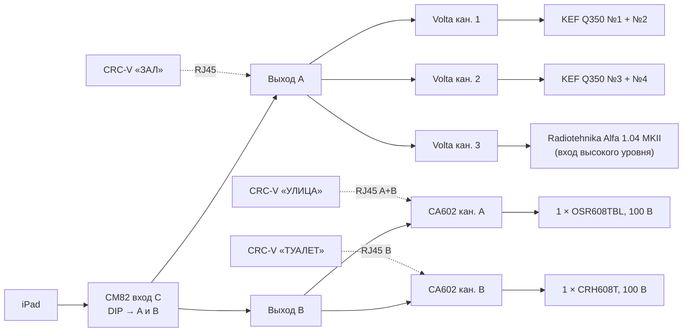

# Теплица · вариант A: KEF Q350, сабвуфер опционально

> Другие варианты и сравнение: [../README.md](../README.md). Смета: [../ESTIMATE.md](../ESTIMATE.md).

> **Актуально на 22.10.2026:** комплектация и цены — по [Google-таблице](https://docs.google.com/spreadsheets/d/1uV0goTIWzc8BjLMTEEd3xBQX1XKyCQEsck7-6BgJBb0/edit). Улица — 1 колонка, туалет — 1 потолочная CVGaudio CRH608T (есть в наличии), источник — iPad на настенном кронштейне у шкафа. Расстановка: [`../placement-plan.png`](../placement-plan.png), место управления: [`../wall-ipad-controls.png`](../wall-ipad-controls.png). PDF для согласования: [`../Teplica-zvuk-proekt.pdf`](../Teplica-zvuk-proekt.pdf).

> **Сабвуфер вынесен в опцию** (+49 990 ₽): канал 3 Volta и кабель закладываются сразу, сам сабвуфер можно поставить позже. Смета A без сабвуфера — 265 637 ₽, с сабвуфером — 315 627 ₽. Вариант с колонками KEF Q150 — [A2](../A2-kef-q150/README.md).

Самый «музыкальный» вариант. В зале hi-fi колонки и сабвуфер, на улице и в туалете трансляционные
линии 100 В. Везде одна музыка, у каждой зоны свой регулятор **Lab.gruppen CRC-V**.

| Зона | Колонки | Усилитель | Регулятор CRC-V подключён к |
|---|---|---|---|
| **Зал** | 2 пары **KEF Q350** (8 Ом, пара параллельно = 4 Ом) | **Volta LIVE 4.400**, кан. 1 и кан. 2 | **CM82, RJ45 выхода A** |
| Зал, сабвуфер | активный **Radiotehnika Alfa 1.04 MKII** (10″, 200 Вт) | Volta, кан. 3 → вход высокого уровня сабвуфера | тот же CRC-V «ЗАЛ» |
| **Улица** | 1 × CVGaudio **OSR608TBL** (IP65), отвод 20 Вт | **CA602**, кан. A, 100 В | **CA602, RJ45 «A+B»** |
| **Туалет** | 1 × CVGaudio **CRH608T** (потолочная, есть в наличии), 100 В / 8 Вт | **CA602**, кан. B, 100 В | **CA602, RJ45 «B»** |

Схема: [`schema-zones.png`](schema-zones.png) ([SVG](schema-zones.svg)). Спецификация: [`bom.csv`](bom.csv).

---

## 1. Что подтвердили руководства Lab.gruppen

Руководства CA Series и CM Series (Quick Start Guide) закрыли главные вопросы прошлых версий:

- **CA: свой выносной регулятор на каждый канал.** На 2-канальных моделях два разъёма RJ45:
  - «A+B»: контакт 2 регулирует канал A, контакт 3 регулирует канал B;
  - «B»: контакт 2 регулирует канал B.

  Регулятор CRC-V подключается обычным патч-кордом, кабель до 305 м.
- **CA: ручка громкости на передней панели одна на весь усилитель.** Поэтому громкость по зонам
  регулируют только CRC-V, а передней ручкой задаётся общий предел.
- **CA: режимы выхода.**
  - 4 Ом: для двух колонок по 8 Ом или одной на 4 Ом.
  - 100 В: обязательно с ФВЧ 80 Гц, сумма отводов с запасом не больше мощности усилителя.
  - Мощность одинаковая на 4 и 8 Ом: CA602 даёт 60 Вт на канал, минимальная нагрузка в режиме 100 В — 166 Ом.
- **CA: крепёж для монтажа в стойку и стяжки для двух усилителей в комплекте.** Отдельно покупать не нужно.
- **CA: дежурный режим.** Через 20 минут без сигнала усилитель засыпает и просыпается, когда сигнал появляется.
- **CM82: два разъёма RJ45**, регулятор подключается на каждый выход отдельно (так же, как у CA).
- **CM82: вход с приоритетом — A и E.** Маршрутизация DIP-переключателями: по умолчанию A–D идут
  на выход A, E–H на выход B.

---

## 2. Как работает

- **Регулятор зала стоит до усилителя.** CRC-V «ЗАЛ» подключён к выходу A микшера, то есть до Volta.
  Поэтому одной ручкой меняется громкость и обеих пар, и сабвуфера.
- **Сабвуфер на своём канале.** Канал 3 Volta подаёт сигнал на вход высокого уровня (колоночный вход)
  активного сабвуфера. Так длинную трассу можно сделать обычным акустическим кабелем, без наводок,
  которые ловит длинный RCA. Уровень баса задаётся ручкой канала 3 на Volta и регулятором на сабвуфере.
- **Кан. 4 Volta свободен.** Его можно использовать для пятой колонки или второго сабвуфера.

---

## 3. Колонки зала: KEF Q350

**Цена:** 2 пары по 39 000 ₽, всего 78 000 ₽.

| Параметр | KEF Q350 |
|---|---|
| Тип | полочная, 2-полосная, коаксиальный излучатель Uni-Q (6,5″ + 1″) |
| Сопротивление | 8 Ом номинал, минимум 3,7 Ом |
| Чувствительность | 87 дБ (2,83 В / 1 м) |
| Рекомендуемая мощность усилителя | 15–120 Вт |
| Максимальный уровень | 110 дБ |

**Подключение пары.** От канала Volta кабель идёт к первой колонке, от её клемм шлейфом ко второй,
«+» к «+». Две колонки по 8 Ом параллельно дают 4 Ом.

**На что обратить внимание**

1. **Мощность.** Volta на 4 Ом выдаёт 300 Вт на канал, то есть около 150 Вт на каждую KEF.
   Это больше рекомендуемых 120 Вт. При пусконаладке ручки каналов Volta ставятся так, чтобы при
   CRC-V на максимуме уровень не превышал заданного предела. Для фона в кафе на колонку нужно 5–15 Вт.
2. **Минимальное сопротивление пары.** У KEF минимум 3,7 Ом, поэтому у пары на отдельных частотах
   получается около 1,9 Ом, а Volta рассчитан на 4 Ом.
   - На фоновой громкости это не проблема.
   - Если на громкости Volta начнёт уходить в защиту, на нём есть запас: каналы 3 и 4. Колонки можно
     развести по одной на канал (4 канала), а сабвуфер подключить к линейному выходу A микшера.
3. **Монтаж.** Колонки весят около 6 кг. Нужны настенные кронштейны под полочные колонки
   и страховочный тросик. Колонки направлены на зону посадки, высота 2,2–2,6 м.

---

## 4. Сабвуфер: Radiotehnika Alfa 1.04 MKII

- Активный, 10″, 200 Вт (номинальная), 27–120 Гц, корпус 360 × 430 × 395 мм, 18,4 кг. Цена 49 990 ₽.
- Подключение: **вход высокого уровня** (колоночные клеммы) от канала 3 Volta. Вход низкого уровня
  (RCA) — запасной вариант, если сабвуфер стоит рядом со шкафом.
- **Рядом с сабвуфером нужна розетка 230 В.**
- **Настройка:** частота среза на сабвуфере около 80–100 Гц, уровень, фаза. Подбираем на слух
  в зоне посадки.
- **Проверить при покупке:** есть ли автоматическое включение по сигналу (чтобы не включать вручную
  каждое утро) и какие регуляторы на задней панели.
- **Установка:** на пол у стены, на виброопоры. В жилом доме это обязательно.

---

## 5. Улица и туалет: CA602, 100 В

| Линия | Канал / режим | Нагрузка | Загрузка |
|---|---|---|---|
| Улица | кан. A, 100 В, ФВЧ 80 Гц | 1 × OSR608TBL, 20 Вт (можно 30 Вт) | 33 % от 60 Вт |
| Туалет | кан. B, 100 В, ФВЧ 80 Гц | 1 × CRH608T, 8 Вт | 13 % |

На вход обоих каналов CA602 подаётся выход B микшера, параллельно на вход A и вход B
(у CA вход A идёт только на выход A, вход B только на выход B).

---

## 6. Коммутация

| Откуда | Куда | Кабель |
|---|---|---|
| iPad (на кронштейне у шкафа) | CM82, вход C (RCA) | адаптер USB-C → mini-jack + кабель mini-jack → 2×RCA |
| CM82, выход A | Volta, входы кан. 1, 2, 3 (параллельно) | симметричный, Euroblock → разъёмы Volta (тип входов уточнить) |
| CM82, выход B | CA602, вход A и вход B (параллельно) | симметричный 2×0,22 мм², Euroblock |
| Volta кан. 1 / кан. 2 | пара 1 / пара 2 KEF | 2×2,5 мм² до 25 м, дальше 2×4 мм² |
| Volta кан. 3 | сабвуфер, вход высокого уровня | 2×1,5 мм² |
| CA602 кан. A | уличные колонки | 2×1,5 мм², уличный, в трубе |
| CA602 кан. B | колонки туалета | 2×0,75–1,5 мм² |
| CRC-V «ЗАЛ» | CM82, RJ45 выхода A | Cat5e, отдельная линия |
| CRC-V «УЛИЦА» | CA602, RJ45 «A+B» | Cat5e |
| CRC-V «ТУАЛЕТ» | CA602, RJ45 «B» | Cat5e |

**Шкаф 9U** ставится в служебном помещении: у Volta есть вентилятор. Сверху вниз:

1. CM82, 1U.
2. Volta LIVE 4.400: 1,5U, сверху оставить свободное место.
3. CA602 со штатным крепежом, 1U.
4. Вентиляционная панель.
5. Кабель-канал вниз к iPad и регуляторам (iPad — на кронштейне на стене под шкафом).
6. Блок розеток с выключателем.

Отдельный автомат 16 А.

---

## 7. Пусконаладка

1. **Режимы.**
   - CA602: оба канала 100 V, ФВЧ ON.
   - Volta: режим работы каналов стерео / раздельный (не мост).
   - Сабвуфер: частота среза около 80–100 Гц.
2. **Отводы колонок.** Улица 20 Вт, туалет 8 Вт. **Отвод 30 Вт на улице не ставить:** 2 × 30 = 60 Вт, это 100 % канала CA602.
3. **Прозвонка.** Пары KEF мультиметром: должно быть около 3–3,5 Ом. Линии 100 В измерителем импеданса.
4. **Все три CRC-V на максимум.** Мастер A и мастер B на CM82 на максимум, передняя ручка CA602
   на максимум, ручки Volta в минимум.
5. **Предел зала.** Ручками кан. 1 и 2 на Volta довести зал до предела (например, 80–85 дБА).
   Затем кан. 3 и регулятор на сабвуфере до баланса баса. Проверить фазу сабвуфера.
6. **Улица и туалет.** Если при максимуме CRC-V громче нужного, уменьшить отводы колонок
   или переднюю ручку CA602 (она общая на оба канала).
7. **Зафиксировать** все ручки в шкафу. Проверить, что каждый CRC-V управляет только своей зоной.

---

## 8. Что осталось проверить

- [ ] **CRC-V в разъёме «A+B» управляет только каналом A.** По схеме контактов из руководства это так,
      если CRC-V использует контакт 2. Проверить при монтаже. Если он управляет обоими каналами,
      регулятор улицы подключается кабелем с распиновкой из руководства.
- [ ] **Volta LIVE 4.400:** тип входных и выходных разъёмов, переключатель режимов (стерео / параллельно / мост).
      В руководстве этого нет, нужна карточка товара или осмотр.
- [ ] **Volta и пары KEF:** как Volta работает на минимальном сопротивлении около 1,9 Ом (см. раздел 3).
- [ ] **Radiotehnika Alfa 1.04 MKII:** автовключение, регуляторы, клеммы входа высокого уровня.
- [ ] **Отводы OSR608TBL** по паспорту.
