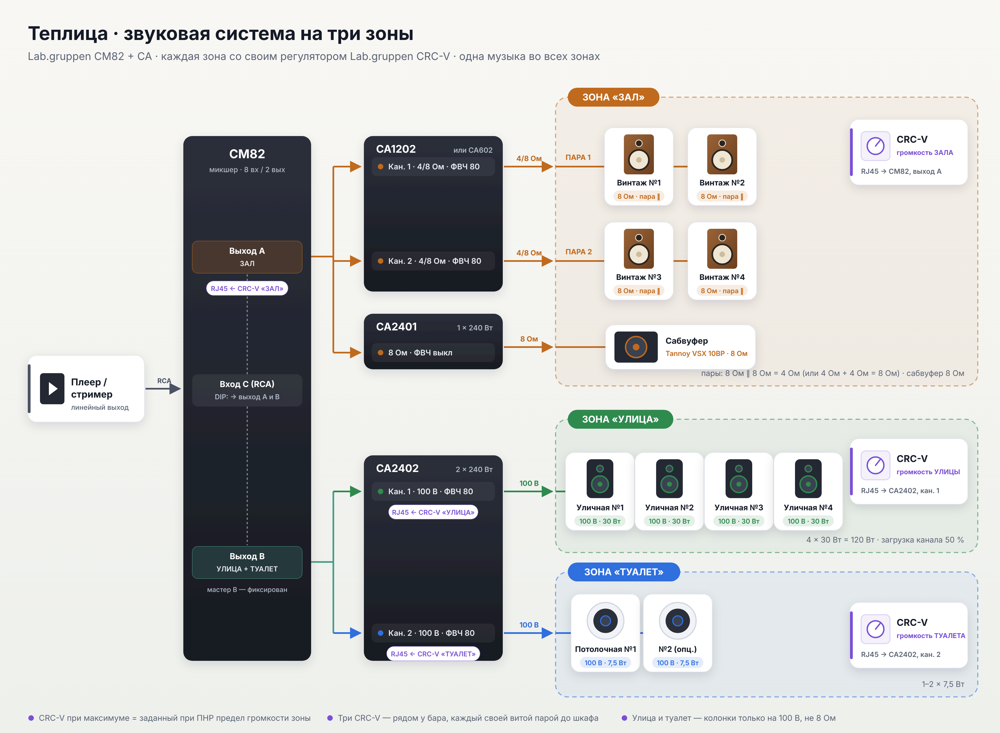
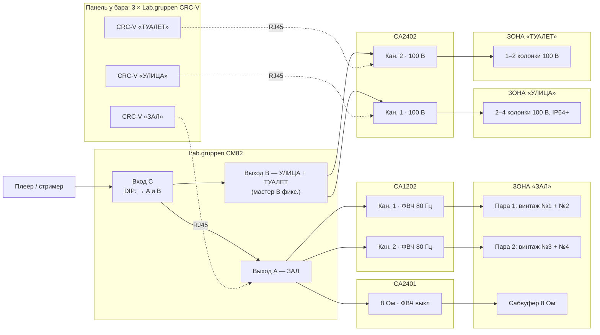

# Теплица: звуковая система кафе на Lab.gruppen CA + CM82

Фоновая музыка в трёх зонах. Везде играет одна и та же музыка, а громкость каждой зоны персонал
регулирует **своим настенным регулятором Lab.gruppen CRC-V**:

| Зона | Колонки | Подключение | Регулятор |
|---|---|---|---|
| **Зал** | 4 винтажные hi-fi колонки (две пары) + сабвуфер | низкоомное, 4 / 8 Ом | CRC-V «ЗАЛ» → CM82, выход A |
| **Улица** | 2–4 всепогодные колонки | линия 100 В | CRC-V «УЛИЦА» → CA2402, канал 1 |
| **Туалет** | 1–2 потолочные колонки | линия 100 В | CRC-V «ТУАЛЕТ» → CA2402, канал 2 |

Оборудование: микшер-предусилитель **Lab.gruppen CM82**, усилители **Lab.gruppen CA1202, CA2401, CA2402**,
три настенных регулятора **Lab.gruppen CRC-V**.

Оформленная схема: [`schema-zones.png`](schema-zones.png) ([SVG](schema-zones.svg)).
Спецификация: [`bom.csv`](bom.csv).

---

## 1. Исходные данные и допущения

| Параметр | Принято в проекте |
|---|---|
| Зал | 80–150 м², потолок 3–4 м |
| Улица | летняя терраса или зона у входа, 30–60 м², работает сезонно |
| Туалет | 1–2 помещения, одна зона громкости |
| Уровни | зал: днём 65–75 дБА, вечером до 80–85 дБА; улица: 65–75 дБА; туалет: 60–70 дБА |
| Источник | один музыкальный плеер / стример с линейным выходом |
| Объявления | микрофон опционален: вход с приоритетом заложен, звук только в зал |

---

## 2. Архитектура

### 2.1. Три зоны из двухзонного микшера

У CM82 **два моновыхода**, а зон три:

- **Выход A** идёт на зал: обе пары колонок и сабвуфер.
- **Выход B** идёт на улицу и туалет. Эти зоны сидят на **разных каналах CA2402**, а у каждого канала
  свой выносной регулятор.

Музыка подаётся на вход C. DIP-переключатель этого входа включён, поэтому сигнал идёт сразу на оба выхода.

| Зона | Выход CM82 | Усилитель / канал | Режим | Регулятор CRC-V подключён к |
|---|---|---|---|---|
| Зал, пара 1 | A | CA1202, кан. 1 | 4 Ом или 8 Ом (см. раздел 3) | **CM82, RJ45 выхода A**: зал регулируется целиком, пары и сабвуфер вместе |
| Зал, пара 2 | A | CA1202, кан. 2 | то же | |
| Зал, сабвуфер | A | CA2401 | 8 Ом | |
| **Улица** | B | CA2402, кан. 1 | 100 В | **CA2402, RJ45 канала 1** |
| **Туалет** | B | CA2402, кан. 2 | 100 В | **CA2402, RJ45 канала 2** |

Мастер B на CM82 стоит в фиксированном положении. Уровень улицы и туалета регулируют их CRC-V.

### 2.2. Почему так

- **Зал на низком сопротивлении.** Без трансформаторов звук плотнее и чище, и сюда можно поставить
  обычные hi-fi колонки, в том числе винтажные. Пары колонок на отдельных каналах CA1202 работают как
  две подзоны зала: при пусконаладке их можно выровнять между собой.
- **Сабвуфер на отдельном CA2401.** Ручка CA2401 задаёт баланс баса один раз при пусконаладке. Дальше
  CRC-V «ЗАЛ» меняет громкость колонок и сабвуфера вместе, потому что подключён к выходу A микшера,
  то есть **до** усилителей зала.
- **Улица и туалет на линии 100 В.** Здесь можно проложить длинную трассу тонким кабелем, громкость
  каждой колонки подбирается отводом, а колонка не получит больше мощности своего отвода.
- **Три регулятора CRC-V вместе.** Удобно повесить их рядом у бара в общей рамке на три поста и подписать
  «ЗАЛ / УЛИЦА / ТУАЛЕТ». Регулятор туалета **не ставить в самом туалете**, иначе гости будут его крутить.

---

## 3. Колонки зала: недорогие винтажные hi-fi

**Бюджет:** 15–20 тыс. ₽ за колонку, то есть 30–40 тыс. ₽ за пару и 60–80 тыс. ₽ за все четыре.
Можно б/у.

### 3.1. Правила выбора

1. **Брать 4 одинаковые колонки** (две пары одной модели). Иначе пары будут звучать по-разному.
2. **Сопротивление определяет, как собрать пару.** Минимальная нагрузка CA — 4 Ом.

   | Номинал колонки | Пара собирается | Нагрузка канала | Режим CA1202 |
   |---|---|---|---|
   | **8 Ом** | параллельно | 4 Ом | 4 Ω |
   | **4 Ом** | **последовательно** | 8 Ом | 8 Ω |
   | 6 Ом | последовательно | 12 Ом | 8 Ω (мощность ниже, для фона хватает) |

   **Параллельно 4- и 6-омные колонки соединять нельзя:** выйдет 2–3 Ом, это ниже минимума усилителя.
3. **Мощность.** Винтажные колонки часто рассчитаны на 25–50 Вт.
   - Колонки от 60 Вт: оставляем **CA1202** (около 60 Вт на колонку).
   - Колонки на 25–50 Вт: вместо CA1202 ставим **CA602** (около 30 Вт на колонку). Для фона в кафе этого
     достаточно, средняя мощность на колонку там около 5–10 Вт.
   - В любом случае ФВЧ 80 Гц на усилителе включён, а максимум громкости ограничивается при пусконаладке
     (раздел 7).
4. **Состояние б/у.**
   - Проверьте подвесы вуферов: поролон на колонках 80–90-х часто рассыпается. Переклейка стоит недорого.
   - Проверьте твитеры на хрип и отсутствие звука, а также что нет дребезга на громкости.
5. **Монтаж.** Полочные колонки весят 4–7 кг. Нужны настенные кронштейны и страховочный тросик.
   Пружинные клеммы на старых колонках не примут 2,5 мм²: обожмите на кабель штыревые наконечники.

### 3.2. Что искать

Цены — ориентир по б/у рынку. Перед покупкой проверьте объявления и паспортное сопротивление конкретной
модели (указано на табличке сзади).

| Модель | Вид / эпоха | Номинал | Ориентир за колонку | Комментарий |
|---|---|---|---|---|
| **Yamaha NS-10M** | чёрный корпус, белый вуфер; культовый студийный монитор 1978–2001 | 8 Ом | 15–25 тыс. ₽, верхняя граница бюджета | Самый узнаваемый винтажный вид. Мощность скромная (около 25 Вт номинальной), поэтому лучше с **CA602** и с ограничением громкости. Четыре одинаковые найти реально, модель массовая |
| **Tannoy Mercury** (M2, m20, MX2 и др.) | британские полочные колонки 90-х–2000-х, шпон | 8 Ом | заметно ниже бюджета | Tannoy сейчас в одной группе с Lab.gruppen. Ровный «тёплый» звук, недорого. Внешне скромнее NS-10M |
| **Celestion Ditton** (15, 25 и др.) | 70-е–80-е, дерево, тканевая решётка | проверить по табличке | в бюджете (зависит от состояния) | Самые «винтажные» на вид. Часто нужна реставрация |
| **Радиотехника S-30B / S-50B** и аналоги | советская классика 80-х | проверить: часть советских АС 4 Ом | ниже бюджета | Атмосферно для «Теплицы». Если окажутся 4 Ом, пару собираем последовательно. Почти наверняка нужна ревизия |
| Новые «под ретро», например Klipsch R-41M / R-51M | новые, медный вуфер | проверить (обычно 8 Ом) | в бюджете | Если не хочется возиться с б/у: гарантия и одинаковые экземпляры |

**Моя рекомендация:**

- По виду: **Yamaha NS-10M + CA602**. Узнаваемая классика, и мощность усилителя под неё.
- По надёжности и цене: **Tannoy Mercury + CA1202**.

---

## 4. Расчёт мощности

| Линия | Усилитель | Нагрузка | Комментарий |
|---|---|---|---|
| Зал, пара 1 и пара 2 | CA1202 (2×120 Вт) или CA602 (2×60 Вт) | 2 колонки на канал | 60 или 30 Вт на колонку. Около 95 или 92 дБ пиково на 4 м при чувствительности около 88 дБ. Для 75–85 дБА хватает |
| Сабвуфер | CA2401 (240 Вт / 8 Ом) | Tannoy VSX 10BP (200 Вт) | хорошее согласование |
| Улица | CA2402 кан. 1 (240 Вт / 100 В) | 4 × 30 Вт = 120 Вт (50 %) | запас ещё на 2 колонки по 30 Вт |
| Туалет | CA2402 кан. 2 (240 Вт / 100 В) | 1–2 × 7,5 Вт | колонке не достанется больше отвода |

В режиме 100 В у CA усиление 38 дБ: полная мощность получается уже примерно при +4 dBu на входе.
Выход CM82 рассчитан до +22 dBu. Поэтому регуляторы на усилителях обычно стоят ниже максимума.

---

## 5. Коммутация

### 5.1. Входы CM82

| Вход | Источник | Маршрут | Примечание |
|---|---|---|---|
| A | микрофон объявлений (опц.) | только выход A | приоритет / VOX |
| **C** | **плеер** (RCA, сумма в моно) | выход A + **DIP «на выход B» ВКЛ** | одна музыка во всех зонах |
| D | резервный источник | только выход A | |
| B, E–H | резерв | | |

### 5.2. Сигнальные линии и регуляторы

| Откуда | Куда | Кабель |
|---|---|---|
| CM82 выход A | CA1202 вход кан. 1 и кан. 2, вход CA2401 (параллельно) | симметричный экранированный 2×0,22 мм² внутри шкафа |
| CM82 выход B | CA2402 вход кан. 1 и кан. 2 (параллельно) | то же |
| **CRC-V «ЗАЛ»** | **CM82, RJ45 выхода A** | Cat5e U/UTP, отдельная линия до шкафа |
| **CRC-V «УЛИЦА»** | **CA2402, RJ45 канала 1** | Cat5e U/UTP |
| **CRC-V «ТУАЛЕТ»** | **CA2402, RJ45 канала 2** | Cat5e U/UTP |

CRC-V работает по кабелю до 305 м. От каждого регулятора в шкаф идёт своя витая пара, без
разветвлений. Формат регулятора: CRC-VEU (европейский подрозетник), чёрный или белый.

### 5.3. Акустические линии

| Линия | Усилитель / режим | Нагрузка | Кабель |
|---|---|---|---|
| L1 «Зал, пара 1» | CA1202 кан. 1 / 4 Ω (или 8 Ω) | 2 колонки | 2×2,5 мм² до 25 м, дальше 2×4 мм² |
| L2 «Зал, пара 2» | CA1202 кан. 2 / 4 Ω (или 8 Ω) | 2 колонки | то же |
| L3 «Сабвуфер» | CA2401 / 8 Ω, ФВЧ выкл | 8 Ом | 2×2,5 мм² до 15 м |
| L4 «Улица» | CA2402 кан. 1 / 100 V, ФВЧ вкл | 4 × 30 Вт ≈ 83 Ом | 2×1,5 мм², уличный (УФ, мороз), в грунте — в трубе ПНД |
| L5 «Туалет» | CA2402 кан. 2 / 100 V, ФВЧ вкл | 1 шт. ≈ 1333 Ом | 2×0,75–1,5 мм² |

Внутри помещений кабель в исполнении нг(А)-LS. Полярность (+/−) соблюдайте на всех колонках.

---

## 6. Размещение

- **Зал.** Пара 1 у бара и входа, пара 2 в зоне посадки. Колонки на кронштейнах на высоте 2,2–2,6 м,
  наклон вниз 10–20°. Сабвуфер на полу у стены, на виброопорах.
- **Улица.** Колонки под навесом, направлены вниз на столики, а не на окна жилых домов и не в открытые двери зала.
- **Туалет.** Одна колонка на помещение, по центру потолка.
- **Регуляторы CRC-V.** Три поста рядом у бара, в зоне персонала, с подписями.
- **Шкаф 9U** в служебном помещении, сверху вниз:
  1. CM82
  2. CA1202 (или CA602) + CA2401
  3. CA2402 + заглушка
  4. вентиляционная панель
  5. полка с плеером
  6. блок розеток с выключателем

  Отдельный автомат 16 А.

---

## 7. Пусконаладка

1. **Режимы усилителей**
   - CA1202: оба канала 4 Ω (8-омные колонки параллельно) или 8 Ω (4-омные колонки последовательно), ФВЧ ON.
   - CA2401: 8 Ω, ФВЧ OFF.
   - CA2402: оба канала 100 V, ФВЧ ON.
2. **Колонки.** Улица на отвод 30 Вт, туалет на 7,5 Вт. В зале проверьте мультиметром нагрузку каждой пары:
   она должна быть не меньше 3,2 Ом (для 4 Ом) или около 6,5 Ом (для 8 Ом).
3. **CM82.** DIP входа C «на выход B» ВКЛ, остальные выключены.
4. **Все три CRC-V выкрутите на максимум.** При этом положении выставляются максимальные уровни зон:
   - **Зал:** мастер A на максимум, затем регуляторы CA1202 до **максимально допустимого уровня**
     (например, 80–85 дБА). Если колонки маломощные, уровень ниже: на громких местах не должно быть
     хрипа и искажений.
   - **Сабвуфер:** регулятором CA2401 добейтесь баланса баса. Затем проверка фазы: переставьте местами
     + и − на сабвуфере и оставьте вариант, где бас плотнее.
   - **Улица:** мастер B зафиксирован, регулятор кан. 1 CA2402 выставьте на максимум для улицы
     (около 75 дБА у столиков).
   - **Туалет:** регулятор кан. 2 CA2402 выставьте на максимум для туалета (около 70 дБА).
5. **Зафиксируйте** положения всех регуляторов в шкафу (фото или маркер) и закройте шкаф.
   Теперь каждый CRC-V регулирует свою зону **от нуля до заданного максимума**, и превысить его нельзя.
6. **Проверьте независимость зон:** CRC-V «УЛИЦА» в ноль, а зал и туалет играют как раньше. Так же
   с каждым регулятором.

**Эксплуатация.**

- Зимой CRC-V «УЛИЦА» в ноль.
- После 22–23 часов сначала убирают улицу, затем зал.
- У CA есть автоматический режим ожидания (около 20 минут без сигнала).

---

## 8. Ограничения

- **Третья зона и регуляторы держатся на раздельных RJ45 у CA2402** (по одному на канал). По описаниям
  дистрибьюторов это так, но источники расходятся, один или два разъёма. Подтвердить по руководству до закупки.
- **CRC-V и CM82.** Lab.gruppen заявляет CRC-V для серий CA, CM, CMA и CPA. Что регулятор подключается
  именно к выходу A микшера CM82, нужно подтвердить по руководству. Запасной вариант: CRC-V «ЗАЛ»
  на CA1202. Тогда сабвуфер регулируется отдельно, и такая схема хуже.
- **Нет активного кроссовера.** ФНЧ для сабвуфера делает его полосовой корпус, ФВЧ для колонок делает CA.
  Для фона этого достаточно. Для «клубного» звука нужен DSP-процессор.
- **Всё в моно.** CM82 суммирует стерео. Для распределённой фоновой системы это правильно.
- **Винтажные колонки не рассчитаны на работу по 12 часов в день на громкости.** На фоновом уровне
  они это выдерживают. Ограничение максимума регуляторами — обязательная часть пусконаладки.
- **Не система оповещения о пожаре (СОУЭ).** Отключение музыки по сигналу пожарной тревоги можно
  завести на контакт приоритета CM82, но схему нужно согласовать с проектировщиком СОУЭ.
- **Музыка в публичном месте:** нужны лицензии РАО/ВОИС или сервис фоновой музыки с такой лицензией.
- **Улица и жилой дом:** соблюдать местный закон о тишине.

---

## 9. Что сверить перед закупкой

- [ ] **CA2402:** отдельный RJ45 и отдельная регулировка на каждый канал. Без этого не будет зон
      «УЛИЦА» и «ТУАЛЕТ» на одном усилителе.
- [ ] **CM82 + CRC-V:** какой разъём RJ45 управляет выходом A.
- [ ] CA1202 / CA602: мощность на 4 и 8 Ом, раздельная регулировка каналов.
- [ ] CA2401: мощность на 8 Ом. Артикул комплекта для монтажа двух половинных приборов в 1U.
- [ ] Колонки зала: номинал на табличке (4, 6 или 8 Ом), мощность, состояние подвесов и твитеров.
- [ ] Уличные колонки: степень защиты IP, отводы на 100 В.

## 10. Что уточнить у заказчика

1. План зала, где будут бар и посадка, как разбить зал на две подзоны.
2. Улица: площадь, есть ли навес, длина трассы от шкафа.
3. Сколько санузлов.
4. Где повесить панель с тремя CRC-V.
5. Что важнее в колонках: вид (NS-10M, Ditton) или цена и надёжность (Mercury).
