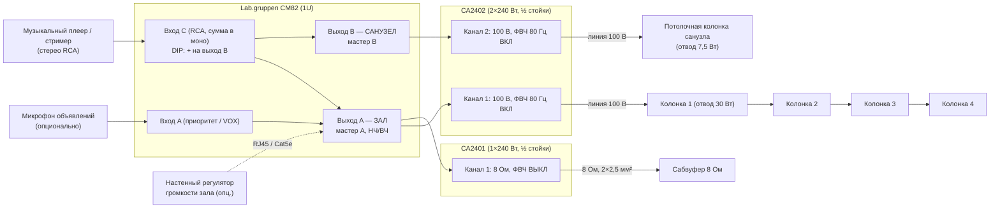

# Звуковая система кафе: Lab.gruppen CA + CM82

Проект фоновой музыки для кафе или ресторана:

- **Зал**: 4 акустические системы и сабвуфер.
- **Санузел**: отдельная зона, в ней играет та же музыка, громкость регулируется отдельно.
- Оборудование: микшер-предусилитель **Lab.gruppen CM82** и усилители **Lab.gruppen серии CA**.

---

## 1. Исходные данные и допущения

| Параметр | Принято в проекте |
|---|---|
| Площадь зала | 80–150 м², одно помещение (с баром или без) |
| Высота потолка | 3–4 м |
| Санузлы | 1–2 помещения, одна общая зона громкости |
| Характер звука | фон днём 65–75 дБА, вечером до 80–85 дБА в зале |
| Источник | один музыкальный плеер/стример (сервис фоновой музыки, ПК или планшет) |
| Объявления | микрофон опционален: вход с приоритетом заложен, звук только в зал |

Если реальное помещение сильно отличается (больше 150 м², сильно вытянутое, есть летняя терраса или
второй зал), меняется число колонок и отводы трансформаторов. Схема и усилители при этом остаются прежними
(запас мощности см. в разделе 4).

---

## 2. Архитектура

Микшер CM82 даёт **два моновыхода (две зоны)**:

- **Выход A — «Зал»**: колонки и сабвуфер.
- **Выход B — «Санузел»**.

Музыка заводится на один вход. DIP-переключатель маршрутизации этого входа включается, и сигнал
одновременно уходит на оба выхода. В обеих зонах играет одна и та же музыка, а громкость у каждой
своя: мастер A и мастер B на CM82.

### Почему именно так

**Колонки зала и санузла работают на трансляционной линии 100 В.**

- Все 4 колонки зала висят на одном канале шлейфом, один кабель на всю линию.
- Громкость каждой колонки подстраивается отводом трансформатора. Например, колонка у барной стойки,
  где персонал стоит весь день, ставится на отвод ниже.
- Линию легко расширить: терраса, второй санузел.
- Нижние частоты всё равно отдаёт сабвуфер. Поэтому включённый фильтр 80 Гц на каналах 100 В
  не мешает, а защищает трансформаторы колонок от насыщения (так рекомендует Lab.gruppen).

**Сабвуфер получает отдельный одноканальный усилитель CA2401 в низкоомном режиме.**

- Ручка громкости на передней панели CA2401 и есть регулятор уровня сабвуфера.
- Баланс «бас / верха» выставляется один раз при пусконаладке и потом не уходит.
- Мастер A на CM82 одновременно меняет громкость и колонок, и сабвуфера.

**Санузел подключён ко второму каналу CA2402 в режиме 100 В.**

- Колонке с отводом 7,5 Вт не достанется больше её отвода, даже если выкрутить всё на максимум,
  потому что выход ограничен напряжением 100 В.
- Мощный канал на маленькую колонку здесь безопасен.

**Компоновка в стойке.** CA2402 и CA2401 сделаны в половину 19″ и встают рядом в 1U. Вся система
занимает 2U плюс полку под плеер.

---

## 3. Спецификация оборудования

Полная спецификация лежит в [`bom.csv`](bom.csv). Схема картинкой: [`schema.svg`](schema.svg). Кратко:

| № | Позиция | Кол-во | Назначение |
|---|---|---|---|
| 1 | **Lab.gruppen CM82**: микшер 8 входов / 2 выхода, 1U | 1 | Источники, две зоны, приоритет микрофона |
| 2 | **Lab.gruppen CA2402**: 2×240 Вт, 4/8 Ом или 70/100 В, ½ 19″ | 1 | Кан. 1: зал (100 В), кан. 2: санузел (100 В) |
| 3 | **Lab.gruppen CA2401**: 1×240 Вт, 4/8 Ом или 70/100 В, ½ 19″ | 1 | Сабвуфер (8 Ом) |
| 4 | Комплект для установки двух половинных приборов в 1U (аксессуар Lab.gruppen) | 1 | Монтаж CA2402 и CA2401 в стойку |
| 5 | Колонки зала с трансформатором 100 В, 6″–6,5″ коаксиальные, ≥60 Вт. Вариант «открытый потолок / лофт»: **Tannoy DVS 6t** (накладные, IP64). Вариант «подвесной потолок»: **Tannoy CVS 6** (встраиваемые) | 4 | Зал |
| 6 | Сабвуфер пассивный 10″, 8 Ом, например **Tannoy VSX 10BP** (полосовой, 200 Вт, 42–110 Гц по −3 дБ) | 1 | Зал, низ |
| 7 | Колонка санузла с трансформатором 100 В: **Tannoy CVS 4** (в подвесной потолок) или **DVS 4t** (накладная) | 1–2 | Санузел |
| 8 | Настенный регулятор громкости, RJ45 (CRC-V или совместимый с CM82; уточнить у дистрибьютора) | 1 (опц.) | Громкость зала с бара |
| 9 | Микрофон объявлений + настенная XLR-розетка | 1 (опц.) | Объявления в зал |
| 10 | Музыкальный плеер / стример с линейным выходом | 1 | Источник |
| 11 | Шкаф настенный 19″, 9U, глубина ≥450 мм, с полкой и блоком розеток с выключателем | 1 | Размещение |

Tannoy входит в ту же группу, что и Lab.gruppen (Music Tribe), поэтому его модели взяты для примера.
Подойдут любые колонки с такими же параметрами: трансформатор 100 В с отводом не меньше 30 Вт,
чувствительность около 90 дБ (1 Вт / 1 м).

---

## 4. Расчёт мощности

### Линия зала: CA2402, канал 1, 100 В

- 4 колонки × 30 Вт = **120 Вт**. Это 50 % от 240 Вт, а рекомендуемый предел загрузки линии 80 %, то есть 192 Вт.
- Запас позволяет добавить ещё **2 колонки по 30 Вт** (например, на террасу) без замены усилителя.
- Проверка звукового давления. Колонка 90 дБ (1 Вт / 1 м) на отводе 30 Вт даёт около 105 дБ на 1 м.
  На расстоянии 4 м это около 93 дБ пикового уровня от одной колонки. Для фона 75–85 дБА с запасом
  на пики этого хватает.
- Днём можно поставить отводы 15 Вт: громкость упадёт на 3 дБ, и персонал физически не сможет
  сделать громче.

### Сабвуфер: CA2401, 8 Ом

- 240 Вт на 8 Ом при номинальной мощности сабвуфера 200 Вт (длительная). Хорошее согласование
  для фоновой и вечерней музыки.

### Санузел: CA2402, канал 2, 100 В

- 1–2 колонки × 7,5 Вт = 7,5–15 Вт. Если в санузле тихо, достаточно и 3,75 Вт на линии 70 В,
  но для простоты оба канала оставлены на 100 В.

### Структура усиления

- В режиме 100 В у CA усиление 38 дБ. Полную мощность усилитель выдаёт уже примерно при **+4 dBu**
  на входе.
- Выход CM82 рассчитан до +22 dBu, поэтому регулятор на CA2402 почти никогда не стоит на максимуме.
- Правильная настройка описана в разделе 7.

---

## 5. Коммутация

### 5.1. Входы CM82

| Вход CM82 | Источник | Разъём | Маршрут | Примечание |
|---|---|---|---|---|
| **A** | Микрофон объявлений (опц.) | Euroblock 5-pin | только выход A | Вход с приоритетом. Порог срабатывания приглушения музыки задаётся ручкой VOX. Фантомное питание +48 В включать только для конденсаторного микрофона |
| B | — (резерв) | Euroblock 5-pin | — | |
| **C** | Основной плеер | RCA L/R (сумма в моно) | выход A + **DIP «на выход B» ВКЛ** | Одна музыка в обе зоны |
| D | Резервный источник (ТВ, ноутбук, Bluetooth-приёмник) | RCA | только выход A | В санузел не идёт |
| E–H | — (резерв) | Euroblock / RCA | по умолчанию на выход B | |

> На CM82 по умолчанию входы A–D идут на выход A, а входы E–H на выход B. DIP-переключатель на задней
> панели добавляет вход ещё и на второй выход. Для входа C его нужно **включить**.

### 5.2. Выходы CM82 и усилители

| Откуда | Куда | Кабель |
|---|---|---|
| CM82 выход A (Euroblock, симм.) | CA2402 вход кан. 1 | симметричный экранированный 2×0,22 мм², перемычка внутри шкафа |
| CM82 выход A (параллельно) | CA2401 вход | то же; два входа на одном линейном выходе допустимы |
| CM82 выход B | CA2402 вход кан. 2 | то же |
| CM82 RJ45 «Remote» (опц.) | настенный регулятор у бара | Cat5e U/UTP, до 100 м |

### 5.3. Акустические линии

| Линия | Усилитель / режим | Нагрузка | Кабель | Ожидаемый импеданс линии (1 кГц) |
|---|---|---|---|---|
| L1 «Зал» | CA2402 кан. 1 / **100 В**, ФВЧ ВКЛ | 4 колонки × 30 Вт шлейфом | 2×1,5 мм² | 100² / 120 ≈ **83 Ом** |
| L2 «Сабвуфер» | CA2401 / **8 Ом**, ФВЧ ВЫКЛ | 1 × 8 Ом | 2×2,5 мм² (до 15 м) | ≈ 8 Ом (по постоянному току ≈ 6 Ом) |
| L3 «Санузел» | CA2402 кан. 2 / **100 В**, ФВЧ ВКЛ | 1–2 колонки × 7,5 Вт | 2×0,75–1,5 мм² | 1 шт. ≈ 1333 Ом, 2 шт. ≈ 667 Ом |

- Потери в линии 100 В зала при 2×1,5 мм² и 50 м до последней колонки около 1,5 %, ими можно пренебречь.
- Кабель для общественного помещения берите в исполнении нг(А)-LS (или нг(А)-FRLS по требованию
  проекта). Прокладка: в кабель-каналах или гофре, отдельно от силовых линий 220 В.
- Полярность (+/−) соблюдайте на всех колонках линии. Иначе в зоне между колонками пропадёт бас и «середина».

---

## 6. Размещение

### Колонки зала

- Распределите 4 колонки равномерно, ориентир 1 колонка на 20–35 м². Направляйте их на зоны посадки,
  а не на стены и окна.
- Для накладных (DVS 6t): высота 2,4–2,8 м, наклон вниз 15–20°.
- Для встраиваемых (CVS 6): шаг между колонками примерно 1,5–2 высоты потолка. Если зал больше
  70–80 м² при потолке около 3 м, четырёх потолочных колонок мало для ровного покрытия. Тогда либо
  накладные колонки на стенах, либо 6 потолочных колонок на отводах 15–30 Вт (по мощности
  укладывается, см. раздел 4).
- Не ставьте колонку прямо над рабочим местом бармена или кассой. Если иначе нельзя, ставьте её
  на отвод ниже.

### Сабвуфер

- Пол, у стены: прибавка около 3 дБ. В углу: около 6 дБ, но выше риск «гудящей» комнатной моды.
  Удобно спрятать его под диван, банкетку, подиум или в нишу барной стойки.
- Подложите виброизолирующие опоры (резина или войлок). В жилом доме это обязательно, иначе бас
  уйдёт в перекрытия к соседям.
- Не ставьте сабвуфер вплотную к столику: гостям будет неуютно.

### Санузел

- Одна потолочная колонка на помещение, примерно над центром.
- Если санузлов два (М/Ж), каждая колонка подключается шлейфом к той же линии L3.

### Шкаф

- Шкаф ставьте в служебном помещении или за стойкой. Не на кухне: там жар и жир.
- Усилители CA охлаждаются конвекцией, вентиляторов нет. Над ними оставьте 1U свободным
  или поставьте перфорированную панель.
- Раскладка шкафа 9U сверху вниз:
  1. CM82
  2. CA2402 + CA2401 (рядом в 1U)
  3. вентиляционная панель
  4. полка с плеером
  5. блок розеток с общим выключателем
  6. остальное — резерв или организация кабелей
- Питание: отдельный автомат 16 А, всё оборудование шкафа от одного блока розеток. Так не образуются
  земляные петли и фон 50 Гц.

---

## 7. Пусконаладка

### 7.1. До включения

1. **CA2402**
   - Канал 1: режим **100 V**, ФВЧ **ON**.
   - Канал 2: режим **100 V**, ФВЧ **ON**.
2. **CA2401**: режим **8 Ω**, ФВЧ **OFF**.
3. **Отводы колонок**
   - Зал: **30 W** (у бара можно 15 W).
   - Санузел: **7,5 W**.
   - Переключатель колонки **ни в коем случае не ставить в положение «low impedance / 6 Ω»**
     на линии 100 В.
4. **CM82**
   - Вход C: DIP маршрутизации на второй выход **ВКЛ**.
   - Фантомное питание: ВЫКЛ, если микрофон не конденсаторный.
5. **Прозвонка линий измерителем импеданса** на частоте 1 кГц. Обычный омметр для линий 100 В не годится.
   - Сверьте значения с таблицей 5.3.
   - Проверьте, что нет замыкания жил между собой и на экран или металлоконструкции.

### 7.2. Включение и уровни

1. Все регуляторы в минимум. Включайте по порядку: плеер → CM82 → усилители. Выключайте в обратном порядке.
2. **Плеер**: громкость 90–100 % (с ограничителем громкости, если он есть). На CM82 поднимите
   регулятор входа C так, чтобы на пиках не загорался индикатор перегрузки.
3. **Зал**
   - Мастер A на CM82 выкрутите в **максимум**.
   - Регулятор CA2402 поднимайте, пока в зале не получится **максимально допустимый уровень**,
     например 85 дБА в центре зала на рабочей музыке.
   - Положение регулятора CA2402 зафиксируйте. Теперь персонал регулирует громкость мастером A
     (или настенным регулятором) и **не сможет превысить** заданный максимум.
4. **Сабвуфер**
   - На знакомых треках поднимайте регулятор CA2401 до естественного баланса. Бас должен
     «подпирать», а не «бубнить».
   - **Проверка фазы**: поменяйте местами + и − на сабвуфере и послушайте в зоне посадки
     в 2–4 м от сабвуфера. Оставьте вариант, где бас плотнее.
5. **Санузел**: мастер B примерно на 60–70 дБА. Музыку должно быть слышно, но спокойно.
6. **Тембр**: НЧ/ВЧ на CM82 (регулируются инструментом). Обычно хватает небольшого подъёма
   или ослабления ВЧ по вкусу заказчика.
7. **Микрофон** (если есть)
   - Порог VOX выставьте так, чтобы музыка приглушалась только от голоса, а не от шума зала.
   - Отдельно проверьте, приглушается ли музыка в санузле во время объявления (на CM82 приглушение
     действует на выход, к которому назначен приоритетный вход).
8. **Фиксация**
   - Отметьте положения всех регуляторов (фото или маркер).
   - Закройте шкаф на ключ.
   - Персоналу оставьте только мастер A/B (или настенный регулятор) и плеер.

### 7.3. Энергосбережение

У CA есть автоматический режим ожидания: через ~20 минут без сигнала усилитель засыпает, а при
появлении сигнала включается снова. Выключать усилители на ночь не обязательно, но общий выключатель
блока розеток удобнее.

---

## 8. Ограничения проекта и возможные улучшения

- **Нет активного кроссовера.**
  - Ни CM82, ни CA не умеют фильтр нижних частот для сабвуфера. В этом проекте роль ФНЧ выполняет
    сам полосовой корпус сабвуфера: у VSX 10BP спад около −3 дБ на 110 Гц и −10 дБ на 130 Гц.
    Верха срезаются ФВЧ 80 Гц на CA. Для фоновой музыки в кафе этого достаточно.
  - Если нужен «клубный» звук, между выходом A и усилителями ставится небольшой DSP-процессор 2×4:
    ФНЧ 80–110 Гц / 24 дБ/окт для сабвуфера (рекомендация Tannoy), задержка, лимитер.
- **Всё в моно.** CM82 суммирует стерео в моно. Для фоновой музыки с распределёнными колонками
  это правильно: в любой точке зала слышна вся фонограмма.
- **Это не система оповещения о пожаре (СОУЭ).** СОУЭ проектируется отдельно, на сертифицированном
  оборудовании. Её можно связать с этой системой (отключение музыки по сигналу пожарной тревоги),
  например через замыкающий контакт приоритета на CM82. Схему согласуйте с проектировщиком СОУЭ.
- **Музыка в публичном месте.** Для публичного исполнения нужны лицензии (РАО/ВОИС) или
  сервис фоновой музыки, лицензия которого покрывает публичное исполнение.
- **Жилой дом.** Ночью действуют нормы шума для соседних квартир. После 23:00 стоит понижать громкость
  сабвуфера и зала. Это удобно делать настенным регулятором или отдельным пресетом громкости
  у персонала.

---

## 9. Что сверить по официальной документации перед закупкой

Характеристики собраны по описаниям дистрибьюторов и магазинов. Источники местами расходятся, поэтому
перед закупкой и монтажом проверьте по даташитам и руководствам Lab.gruppen / Tannoy:

- [ ] CM82: какие именно входы имеют приоритет (A и B или A и E), положение DIP-переключателей маршрутизации.
- [ ] CM82: один регулятор НЧ/ВЧ на оба выхода или отдельный на каждый.
- [ ] CM82: назначение двух разъёмов RJ45 (по одному на каждую зону?) и совместимые настенные регуляторы.
- [ ] CA2402: регулятор громкости на передней панели общий на оба канала или раздельный.
- [ ] CA2402 / CA2401: мощность на 8 Ом, наличие ФВЧ 80 Гц на CA2401, артикул комплекта для монтажа двух
      половинных приборов в 1U.
- [ ] Колонки: отводы трансформатора на 100 В (у DVS 6t / CVS 6 по разным источникам 30/15/7,5 Вт или
      60/30/15 Вт). При отводах 60/30/15 Вт для зала берите 30 Вт.

---

## 10. Что уточнить у заказчика

1. План зала с размерами, тип потолка (подвесной или открытый), где барная стойка и где посадка.
2. Сколько санузлов и есть ли в них подвесной потолок.
3. Нужен ли микрофон для объявлений, нужна ли регулировка громкости с бара.
4. Есть ли летняя терраса (её можно добавить на линию L1 или выделить в отдельную зону, см. раздел 4).
5. Жилой ли дом над кафе или рядом с ним.
