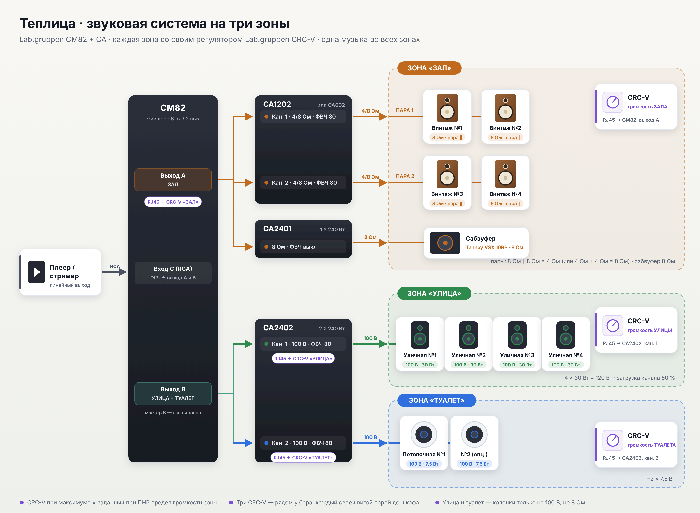

# Теплица: звуковая система, три варианта

Во всех вариантах три зоны: **зал, улица и туалет**. Везде играет одна музыка, а у каждой зоны свой
регулятор громкости у бара.

| | **A** — [Lab.gruppen, винтаж + сабвуфер](A-labgruppen-vintage/README.md) | **B** — [CVGaudio 100 В, самый простой](B-cvg-100v/README.md) | **C** — [Lab.gruppen 100 В + сабвуфер опционально](C-labgruppen-100v-sub/README.md) |
|---|---|---|---|
| Зал | 4 винтажные hi-fi колонки (две пары, низкоомное подключение) + сабвуфер | 5 × CVGaudio OSR608TBL, 100 В | 5–6 × OSR608TBL, 100 В, **сабвуфер можно добавить** |
| Улица | 100 В, 2–4 колонки | 100 В, 4 × OSR608TBL | 100 В, 4 × OSR608TBL |
| Туалет | 100 В | 100 В, 2 × NF4TBL | 100 В, 2 × NF4TBL |
| Электроника | CM82 + CA1202 (или CA602) + CA2401 + CA2402 | REBOX-T18 + REBOX-T12 | CM82 + CA2401 + CA2402 (+ CA2401 под сабвуфер) |
| Регуляторы зон | **3 × Lab.gruppen CRC-V** | 3 × CVGaudio VA (пассивные, 100 В) | **3 × Lab.gruppen CRC-V** |
| Сабвуфер | есть | нет | опция, можно добавить позже |
| Звук в зале | лучший: hi-fi колонки + сабвуфер | обычный фоновый | фоновый, с сабвуфером плотнее |
| Сложность | высокая: подбор б/у колонок, правила подключения пар | минимальная | средняя |
| Цена | высокая | минимальная | средняя |

### Схемы

| A | B | C |
|---|---|---|
|  |  |  |

### Как выбрать

- **Важен вид и звук зала,** зал — главная часть интерьера → **A**.
- **Нужно дёшево и быстро,** музыка просто «чтобы играла» → **B**. Регуляторы зон в этом варианте
  не Lab.gruppen: CRC-V работает только с усилителями Lab.gruppen.
- **Нужно управление Lab.gruppen по зонам и простая надёжная трансляционная система,** а сабвуфер
  по бюджету можно отложить → **C**.

### Общие риски вариантов A и C

Схема с тремя CRC-V держится на двух фактах, которые нужно подтвердить по руководствам до закупки:

1. У CA2402 отдельный RJ45 для каждого канала.
2. CRC-V подключается к выходу A микшера CM82.

Подробнее в разделе «Что сверить» каждого варианта.
