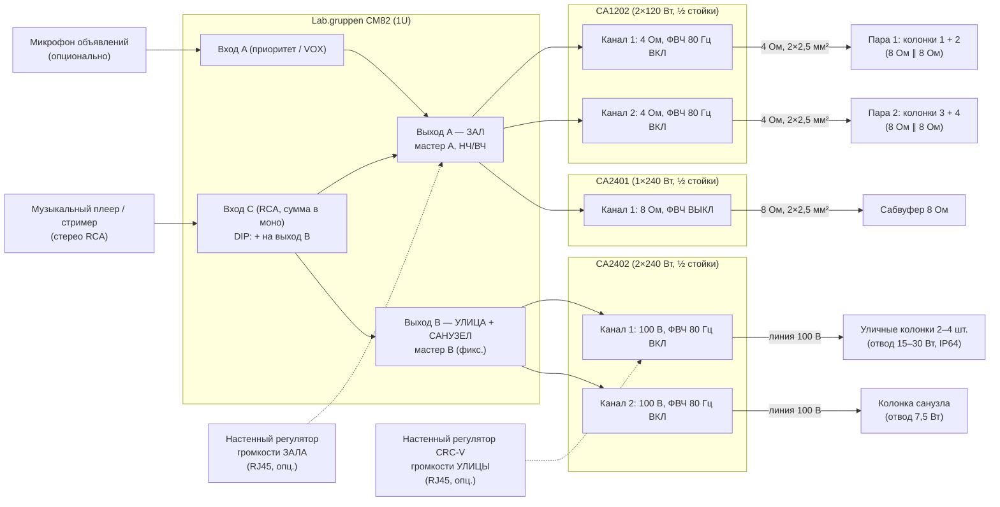

# Звуковая система кафе: Lab.gruppen CA + CM82

Проект фоновой музыки для кафе или ресторана. Три зоны, везде одна и та же музыка, громкость у каждой зоны своя:

- **Зал**: 4 акустические системы по 8 Ом (низкоомное подключение, две пары) и сабвуфер.
- **Санузел**: трансляционная линия 100 В.
- **Улица** (терраса / вход): отдельная трансляционная линия 100 В.

Оборудование: микшер-предусилитель **Lab.gruppen CM82** и усилители **Lab.gruppen серии CA**.

---

## 1. Исходные данные и допущения

| Параметр | Принято в проекте |
|---|---|
| Площадь зала | 80–150 м², одно помещение (с баром или без) |
| Высота потолка | 3–4 м |
| Санузлы | 1–2 помещения, одна общая зона громкости |
| Улица | летняя терраса или зона у входа, 30–60 м², 2–4 уличные колонки, работает сезонно |
| Характер звука | зал: фон днём 65–75 дБА, вечером до 80–85 дБА; улица: 65–75 дБА; санузел: 60–70 дБА |
| Источник | один музыкальный плеер/стример (сервис фоновой музыки, ПК или планшет) |
| Объявления | микрофон опционален: вход с приоритетом заложен, звук только в зал |

---

## 2. Архитектура

### 2.1. Как получается три зоны из двухзонного микшера

У CM82 **два моновыхода**, а зон три. Поэтому зоны «Улица» и «Санузел» получают сигнал с одного
выхода B, но висят на **разных каналах усилителя CA2402**. У CA2402 громкость регулируется отдельно
на каждом канале: ручкой на передней панели и, при желании, настенным регулятором по RJ45 на каждый канал.

| Зона | Выход CM82 | Усилитель / канал | Режим | Чем регулируется громкость |
|---|---|---|---|---|
| **Зал**: 2 пары колонок | A | CA1202, кан. 1 и кан. 2 | 4 Ом (пара 8 Ом параллельно) | мастер A на CM82 (+ настенный регулятор у бара) |
| **Зал**: сабвуфер | A | CA2401 | 8 Ом | вместе с залом мастером A; баланс баса ручкой CA2401 |
| **Улица** | B | CA2402, кан. 1 | 100 В | регулятор кан. 1 CA2402 (+ настенный регулятор CRC-V у бара / у входа) |
| **Санузел** | B | CA2402, кан. 2 | 100 В | регулятор кан. 2 CA2402 (выставляется один раз) |

Мастер B на CM82 стоит в фиксированном положении (см. раздел 7). Им удобно разом приглушить и улицу,
и санузел, но повседневная регулировка улицы делается на её канале усилителя.

Музыка заводится на вход C. DIP-переключатель маршрутизации входа C включается, и сигнал идёт
на оба выхода: и на A, и на B.

### 2.2. Почему именно так

**Зал: колонки 8 Ом, пары на отдельных каналах.**

- Две колонки по 8 Ом параллельно дают 4 Ом. На такой нагрузке CA1202 выдаёт полные 120 Вт на канал,
  то есть **60 Вт на каждую колонку**.
- По сравнению с линией 100 В: нет трансформаторов, а значит нет их потерь и насыщения на басу. Шире
  полоса и лучше демпфирование. Звук в зале получается плотнее и чище, а это основная зона.
- Две пары — это две подзоны зала. Регуляторами каналов CA1202 при пусконаладке выравнивается баланс,
  например пара у бара тише, пара в дальней части громче.
- Пары подключены **параллельно**, а не последовательно. Если одна колонка выйдет из строя (обрыв),
  вторая в паре продолжит играть.
- Фильтр 80 Гц на CA1202 включён. Это раздел «колонки / сабвуфер»: колонки не тратят ход диффузора
  на глубокий бас, его отдаёт сабвуфер.

**Сабвуфер на отдельном CA2401.** Ручка на передней панели CA2401 и есть регулятор уровня баса.
Баланс выставляется один раз, после этого мастер A меняет громкость колонок и сабвуфера вместе.

**Улица и санузел на линиях 100 В.**

- На улице и в санузле важнее простота и надёжность, чем hi-fi.
- Линия 100 В позволяет протянуть длинный кабель меньшего сечения и легко добавить колонку.
- Громкость каждой колонки подстраивается отводом трансформатора.
- Колонка не получит больше мощности своего отвода, даже если выкрутить всё на максимум.
- Включённый фильтр 80 Гц защищает трансформаторы от насыщения (рекомендация Lab.gruppen).

**Улица — отдельный канал с собственной регулировкой.**

- Её включают и выключают по сезону. Вечером громкость на улице нужно снижать раньше, чем в зале
  (соседи, закон о тишине).
- Для этого на канал 1 CA2402 ставится настенный регулятор у бара или у входа.
- Музыка в санузле при этом от улицы не зависит: зимой улица выключена, а в санузле музыка играет.

**Компоновка в стойке.** Три полустоечных усилителя (CA1202, CA2401, CA2402) занимают 2U, одно
половинное место остаётся в резерве. Вместе с CM82 система занимает 3U плюс полку под плеер.

---

## 3. Спецификация оборудования

Полная спецификация лежит в [`bom.csv`](bom.csv). Схема картинкой: [`schema.svg`](schema.svg). Кратко:

| № | Позиция | Кол-во | Назначение |
|---|---|---|---|
| 1 | **Lab.gruppen CM82**: микшер 8 входов / 2 выхода, 1U | 1 | Источники, выход A — зал, выход B — улица + санузел |
| 2 | **Lab.gruppen CA1202**: 2×120 Вт, 4/8 Ом или 70/100 В, ½ 19″ | 1 | Зал: пара 1 и пара 2 (4 Ом) |
| 3 | **Lab.gruppen CA2401**: 1×240 Вт, 4/8 Ом или 70/100 В, ½ 19″ | 1 | Сабвуфер (8 Ом) |
| 4 | **Lab.gruppen CA2402**: 2×240 Вт, 4/8 Ом или 70/100 В, ½ 19″ | 1 | Кан. 1: улица (100 В), кан. 2: санузел (100 В) |
| 5 | Комплект для установки двух половинных приборов в 1U (аксессуар Lab.gruppen) | 2 | Монтаж трёх усилителей, одно место под заглушку |
| 6 | Колонки зала **8 Ом**, 5″–6,5″, ≥75 Вт длительной мощности. Пример: **JBL Control 25-1** (8 Ом в положении THRU, 100 Вт розовый шум / 2 ч) | 4 | Зал, две пары |
| 7 | Сабвуфер пассивный 10″, 8 Ом, например **Tannoy VSX 10BP** (полосовой, 200 Вт, 42–110 Гц по −3 дБ) | 1 | Зал, низ |
| 8 | Уличные колонки с трансформатором 100 В, IP64 и выше, например **Tannoy DVS 6t** | 2–4 | Улица |
| 9 | Колонка санузла с трансформатором 100 В: **Tannoy CVS 4** (в подвесной потолок) или **DVS 4t** (накладная) | 1–2 | Санузел |
| 10 | Настенный регулятор громкости для CM82, RJ45 (совместимость уточнить у дистрибьютора) | 1 (опц.) | Громкость зала с бара |
| 11 | Настенный регулятор **CRC-V** для CA2402, кан. 1 | 1 (опц.) | Громкость улицы |
| 12 | Микрофон объявлений + настенная XLR-розетка | 1 (опц.) | Объявления в зал |
| 13 | Музыкальный плеер / стример с линейным выходом | 1 | Источник |
| 14 | Шкаф настенный 19″, 9U, глубина ≥450 мм, с полкой и блоком розеток с выключателем | 1 | Размещение |

### Внимание при выборе колонок для зала

Колонке нужен **настоящий номинал 8 Ом** в низкоомном режиме. Многие инсталляционные колонки
с трансформатором в режиме «без трансформатора» имеют другой номинал:

- **Tannoy DVS 6 / DVS 6t / CVS 6: 6 Ом.** Пара параллельно даёт **3 Ом**, это ниже минимальных 4 Ом
  для CA. **Так подключать нельзя.**
- **Tannoy AMS 6DC / CMS 603DC: 16 Ом.** Пара параллельно даёт 8 Ом. Подключать можно, но канал
  ставится в режим **8 Ом**, мощность на колонку будет меньше. Если хочется остаться на Tannoy,
  это рабочий вариант.
- **JBL Control 25-1** (или аналог с номиналом 8 Ом): пара параллельно даёт ровно 4 Ом, как
  в этом проекте. У Control 25-1 есть и трансформатор 100 В, поэтому эти же колонки при желании
  можно перевести на трансляционную линию.

---

## 4. Расчёт мощности

### Зал: CA1202, 2 канала × 4 Ом

- 120 Вт на канал на 4 Ом. Это **60 Вт на колонку**, ниже её длительной мощности (75–100 Вт).
  Колонку не перегрузить даже на максимуме.
- Проверка звукового давления. Колонка около 89 дБ (1 Вт / 1 м) при 60 Вт даёт около 107 дБ на 1 м.
  На расстоянии 4 м это около 95 дБ пикового уровня от одной колонки. Для фона 75–85 дБА с запасом
  на пики этого хватает.
- Если в зале нужна «вечеринка» громче 85 дБА, вместо CA1202 ставится CA2402 (120 Вт на колонку).
  Тогда колонки нужны с длительной мощностью от 100 Вт.

### Сабвуфер: CA2401, 8 Ом

- 240 Вт на 8 Ом при номинальной мощности сабвуфера 200 Вт (длительная). Хорошее согласование.

### Улица: CA2402, канал 1, 100 В

- 4 колонки × 30 Вт = **120 Вт** из 240 Вт. Предел загрузки 80 %, то есть 192 Вт.
  Можно добавить ещё 2 колонки по 30 Вт.
- На открытом воздухе нет отражений, и уровень падает на 6 дБ при удвоении расстояния.
  Колонка 90 дБ на отводе 30 Вт даёт около 105 дБ на 1 м и около 89 дБ на 6 м. Для 65–75 дБА
  этого достаточно. Если колонки висят близко к столикам (2–3 м), отвода 15 Вт хватит.

### Санузел: CA2402, канал 2, 100 В

- 1–2 колонки × 7,5 Вт = 7,5–15 Вт. Огромный запас канала безопасен, см. раздел 2.2.

### Структура усиления

- В режиме 100 В у CA усиление 38 дБ. Полную мощность усилитель выдаёт уже примерно при **+4 dBu**
  на входе.
- Выход CM82 рассчитан до +22 dBu, поэтому регуляторы на усилителях почти никогда не стоят на максимуме.
- Правильная настройка описана в разделе 7.

---

## 5. Коммутация

### 5.1. Входы CM82

| Вход CM82 | Источник | Разъём | Маршрут | Примечание |
|---|---|---|---|---|
| **A** | Микрофон объявлений (опц.) | Euroblock 5-pin | только выход A (зал) | Вход с приоритетом. Порог срабатывания приглушения музыки задаётся ручкой VOX. Фантомное питание +48 В включать только для конденсаторного микрофона. Если объявления нужны и на улице, включите DIP «на выход B» (тогда они будут слышны и в санузле) |
| B | — (резерв) | Euroblock 5-pin | — | |
| **C** | Основной плеер | RCA L/R (сумма в моно) | выход A + **DIP «на выход B» ВКЛ** | Одна музыка во всех зонах |
| D | Резервный источник (ТВ, ноутбук, Bluetooth-приёмник) | RCA | только выход A | Только в зал |
| E–H | — (резерв) | Euroblock / RCA | по умолчанию на выход B | |

> На CM82 по умолчанию входы A–D идут на выход A, а входы E–H на выход B. DIP-переключатель на задней
> панели добавляет вход ещё и на второй выход. Для входа C его нужно **включить**.

### 5.2. Выходы CM82 и усилители

Все межблочные перемычки делаются внутри шкафа симметричным экранированным кабелем 2×0,22 мм².
Один линейный выход спокойно работает на 2–3 параллельных входа усилителей.

| Откуда | Куда |
|---|---|
| CM82 выход A | CA1202 вход кан. 1 и вход кан. 2 (параллельно) |
| CM82 выход A | CA2401 вход |
| CM82 выход B | CA2402 вход кан. 1 и вход кан. 2 (параллельно) |
| CM82 RJ45 «Remote» (опц.) | настенный регулятор зала у бара, Cat5e U/UTP |
| CA2402 RJ45 кан. 1 (опц.) | CRC-V «Улица» у бара / у входа, Cat5e U/UTP |

### 5.3. Акустические линии

| Линия | Усилитель / режим | Нагрузка | Кабель | Ожидаемый импеданс линии |
|---|---|---|---|---|
| L1 «Зал, пара 1» | CA1202 кан. 1 / **4 Ом**, ФВЧ ВКЛ | 2 × 8 Ом параллельно | 2×2,5 мм² (до 25 м) | ≈ 4 Ом (по постоянному току ≈ 3–3,5 Ом) |
| L2 «Зал, пара 2» | CA1202 кан. 2 / **4 Ом**, ФВЧ ВКЛ | 2 × 8 Ом параллельно | 2×2,5 мм² (до 25 м) | ≈ 4 Ом (по постоянному току ≈ 3–3,5 Ом) |
| L3 «Сабвуфер» | CA2401 / **8 Ом**, ФВЧ ВЫКЛ | 1 × 8 Ом | 2×2,5 мм² (до 15 м) | ≈ 8 Ом (по постоянному току ≈ 6 Ом) |
| L4 «Улица» | CA2402 кан. 1 / **100 В**, ФВЧ ВКЛ | 2–4 колонки × 15–30 Вт | 2×1,5 мм², уличное исполнение | 4 × 30 Вт ≈ **83 Ом**; 2 × 30 Вт ≈ 167 Ом (на 1 кГц) |
| L5 «Санузел» | CA2402 кан. 2 / **100 В**, ФВЧ ВКЛ | 1–2 колонки × 7,5 Вт | 2×0,75–1,5 мм² | 1 шт. ≈ 1333 Ом, 2 шт. ≈ 667 Ом (на 1 кГц) |

**Подключение пары в зале.** Кабель идёт от усилителя к первой колонке, от её клемм шлейфом ко второй
колонке, «+» к «+» и «−» к «−». Это параллельное соединение. Переключатель колонки ставится в положение
**8 Ом / THRU** (без трансформатора).

**Сечение для низкоомных линий важно.** На 4 Ом сопротивление кабеля съедает мощность и демпфирование.

- 2×2,5 мм² при 20 м до пары: потери около 7 % мощности (0,3 дБ), это допустимо.
- Если до пары больше 25 м, берите 2×4 мм².
- Сечение 2×1,5 мм² для пар зала не годится.

**Уличная линия.**

- Кабель в уличном исполнении (оболочка, стойкая к УФ и морозу) или в трубе / металлорукаве.
- В грунте: только в трубе ПНД.
- Все соединения на улице: в герметичных коробках IP65 и выше.
- Ввод с улицы в здание: через гильзу, с капельной петлёй.

**Общие правила.**

- Внутри помещений кабель в исполнении нг(А)-LS (или нг(А)-FRLS по требованию проекта).
- Прокладка отдельно от силовых линий 220 В.
- Полярность (+/−) соблюдайте на всех колонках. Иначе между колонками пропадёт бас и «середина».

---

## 6. Размещение

### Зал: две пары колонок

- Пары лучше разбить **по подзонам**: пара 1 ближе к бару и входу, пара 2 в дальней части или
  в зоне посадки. Тогда регуляторами каналов CA1202 можно выровнять громкость по залу.
- Ориентир: 1 колонка на 20–35 м². Направляйте колонки на зоны посадки, а не на стены и окна.
- Накладные колонки: высота 2,4–2,8 м, наклон вниз 15–20°.
- Не ставьте колонку прямо над рабочим местом бармена или кассой.

### Сабвуфер

- Пол, у стены: прибавка около 3 дБ. В углу: около 6 дБ, но выше риск «гудящей» комнатной моды.
  Удобно спрятать его под диван, банкетку, подиум или в нишу барной стойки.
- Подложите виброизолирующие опоры (резина или войлок). В жилом доме это обязательно.
- Не ставьте сабвуфер вплотную к столику.

### Улица

- Колонки вешаются **под навесом или козырьком**, даже если они IP64: прямой дождь и солнце сокращают
  срок службы. Высота 2,5–3 м.
- Направление: **вниз, на столики**, а не вдоль улицы и не на окна жилых домов. Лучше больше колонок
  на меньшем отводе, чем пара громких.
- Не направляйте уличные колонки обратно в зал через открытые двери: улица и зал будут мешать друг другу.

### Санузел

- Одна потолочная колонка на помещение, примерно над центром.
- Если санузлов два (М/Ж), каждая колонка подключается шлейфом к той же линии L5.

### Шкаф

- Шкаф ставьте в служебном помещении или за стойкой. Не на кухне: там жар и жир.
- Усилители CA охлаждаются конвекцией, вентиляторов нет. Над ними оставьте 1U свободным
  или поставьте перфорированную панель.
- Раскладка шкафа 9U сверху вниз:
  1. CM82
  2. CA1202 + CA2401 (рядом в 1U)
  3. CA2402 + заглушка (1U)
  4. вентиляционная панель
  5. полка с плеером
  6. блок розеток с общим выключателем
  7. остальное — резерв или организация кабелей
- Питание: отдельный автомат 16 А, всё оборудование шкафа от одного блока розеток. Так не образуются
  земляные петли и фон 50 Гц.

---

## 7. Пусконаладка

### 7.1. До включения

1. **CA1202**
   - Канал 1: режим **4 Ω**, ФВЧ **ON**.
   - Канал 2: режим **4 Ω**, ФВЧ **ON**.
2. **CA2401**: режим **8 Ω**, ФВЧ **OFF**.
3. **CA2402**
   - Канал 1 (улица): режим **100 V**, ФВЧ **ON**.
   - Канал 2 (санузел): режим **100 V**, ФВЧ **ON**.
4. **Колонки**
   - Зал: переключатель в **8 Ω / THRU**.
   - Улица: отвод **30 W** (или 15 W, если колонки близко к столикам).
   - Санузел: отвод **7,5 W**.
   - **Не перепутайте**: колонка в положении 8 Ω / THRU на линии 100 В сгорит. Колонка на отводе
     трансформатора в паре зала будет еле слышна.
5. **CM82**
   - Вход C: DIP маршрутизации на второй выход **ВКЛ**.
   - Фантомное питание: ВЫКЛ, если микрофон не конденсаторный.
6. **Прозвонка линий** до подключения к усилителям, сверка с таблицей 5.3.
   - Пары зала и сабвуфер: мультиметром. Если меньше 3 Ом на паре, ищите ошибку: колонка
     не в положении THRU или замыкание.
   - Линии 100 В: только измерителем импеданса на частоте 1 кГц. Обычный омметр для них не годится.
   - Проверьте, что нет замыкания жил между собой, на экран или металлоконструкции.
     На уличной линии это особенно важно.

### 7.2. Включение и уровни

1. Все регуляторы в минимум. Включайте по порядку: плеер → CM82 → усилители. Выключайте в обратном порядке.
2. **Плеер**: громкость 90–100 %. На CM82 поднимите регулятор входа C так, чтобы на пиках
   не загорался индикатор перегрузки.
3. **Зал**
   - Мастер A на CM82 выкрутите в **максимум**.
   - Регуляторы обоих каналов CA1202 поднимайте, пока в зале не получится **максимально допустимый
     уровень**, например 85 дБА в зоне посадки на рабочей музыке.
   - Затем выровняйте пары между собой: в подзоне каждой пары уровень должен быть примерно одинаковым.
     Пару у бара обычно делают на 2–3 дБ тише.
   - Положения регуляторов CA1202 зафиксируйте. Теперь персонал регулирует зал мастером A
     (или настенным регулятором) и **не сможет превысить** заданный максимум.
4. **Сабвуфер**
   - На знакомых треках поднимайте регулятор CA2401 до естественного баланса. Бас должен
     «подпирать», а не «бубнить».
   - **Проверка фазы**: поменяйте местами + и − на сабвуфере и послушайте в зоне посадки
     в 2–4 м от сабвуфера. Оставьте вариант, где бас плотнее.
5. **Мастер B** на CM82 поставьте в **максимум** (или в положение, при котором индикатор выхода B
   не доходит до перегрузки) и зафиксируйте.
6. **Улица**
   - Регулятор кан. 1 CA2402 поднимите до **максимально допустимого уровня на улице**, например
     75 дБА у столиков.
   - Если стоит CRC-V, этот уровень выставляется при CRC-V на максимуме. Персонал регулирует улицу
     с CRC-V от нуля до заданного максимума.
7. **Санузел**: регулятор кан. 2 CA2402 поставьте на 60–70 дБА в помещении и зафиксируйте.
8. **Тембр**: НЧ/ВЧ на CM82 (регулируются инструментом). Обычно хватает небольшого подъёма
   или ослабления ВЧ по вкусу заказчика.
9. **Микрофон** (если есть): порог VOX выставьте так, чтобы музыка приглушалась только от голоса,
   а не от шума зала.
10. **Фиксация**
    - Отметьте положения всех регуляторов (фото или маркер).
    - Закройте шкаф на ключ.
    - Персоналу оставьте мастер A (или регулятор зала), регулятор улицы и плеер.

### 7.3. Эксплуатация

- **Зима / улица закрыта**: регулятор улицы (CRC-V) в ноль. Зал и санузел работают как обычно.
- **Вечер, после 22–23 часов**: сначала убирают улицу, затем при необходимости снижают зал.
- **Энергосбережение**: у CA есть автоматический режим ожидания. Через ~20 минут без сигнала усилитель
  засыпает, а при появлении сигнала включается снова.

---

## 8. Ограничения проекта и возможные улучшения

- **Третья зона держится на раздельной регулировке каналов CA2402.**
  - По описаниям дистрибьюторов, у CA2402 громкость отдельная для каждого выхода, и на каждую зону можно
    назначить свой выносной регулятор. Это нужно подтвердить по руководству, см. раздел 9.
  - Если окажется, что регулятор у CA2402 общий на оба канала, санузел переносится на выход A
    (вход кан. 2 CA2402 от выхода A). Громкость в санузле тогда будет пропорционально следовать
    за залом, а улица останется единственной зоной на выходе B со своим мастером.
- **Нет активного кроссовера.**
  - Ни CM82, ни CA не умеют фильтр нижних частот для сабвуфера. Роль ФНЧ выполняет полосовой корпус
    сабвуфера: у VSX 10BP спад около −3 дБ на 110 Гц и −10 дБ на 130 Гц. Колонки зала срезаются
    ФВЧ 80 Гц на CA1202. Для фоновой музыки в кафе этого достаточно.
  - Если нужен «клубный» звук, между выходом A и усилителями ставится небольшой DSP-процессор:
    ФНЧ 80–110 Гц / 24 дБ/окт для сабвуфера, ФВЧ для колонок, задержка, лимитер. С DSP можно сделать
    и полноценную третью (и четвёртую) зону.
- **Всё в моно.** CM82 суммирует стерео в моно. Для фоновой музыки с распределёнными колонками
  это правильно: в любой точке зала слышна вся фонограмма.
- **Это не система оповещения о пожаре (СОУЭ).** СОУЭ проектируется отдельно, на сертифицированном
  оборудовании. Её можно связать с этой системой (отключение музыки по сигналу пожарной тревоги),
  например через замыкающий контакт приоритета на CM82. Схему согласуйте с проектировщиком СОУЭ.
- **Музыка в публичном месте.** Для публичного исполнения нужны лицензии (РАО/ВОИС) или
  сервис фоновой музыки, лицензия которого покрывает публичное исполнение.
- **Шум на улице и в жилом доме.** Региональные законы о тишине (обычно с 22–23 до 7–8 часов) особенно
  касаются уличной зоны. Уличные колонки направляйте на свою территорию. Ночью улицу выключайте,
  а сабвуфер и зал приглушайте.

---

## 9. Что сверить по официальной документации перед закупкой

Характеристики собраны по описаниям дистрибьюторов и магазинов. Источники местами расходятся, поэтому
перед закупкой и монтажом проверьте по даташитам и руководствам Lab.gruppen / JBL / Tannoy:

- [ ] **CA2402: регулятор громкости на передней панели и выносной регулятор отдельные для каждого канала**
      (ключевой пункт для зоны «Улица»). Количество разъёмов RJ45 (источники пишут то один, то два).
- [ ] CA1202: раздельная регулировка каналов (для баланса пар), мощность 120 Вт на 4 Ом в режиме 4 Ом.
- [ ] CM82: какие именно входы имеют приоритет (A и B или A и E), положение DIP-переключателей маршрутизации.
- [ ] CM82: один регулятор НЧ/ВЧ на оба выхода или отдельный на каждый. Назначение разъёмов RJ45
      и совместимые настенные регуляторы.
- [ ] CA2401: мощность на 8 Ом. Артикул комплекта для монтажа половинных приборов в 1U.
- [ ] Колонки зала: номинал **8 Ом** в низкоомном режиме (не 6 и не 16 Ом), длительная мощность ≥75 Вт.
- [ ] Уличные колонки: степень защиты IP, отводы трансформатора на 100 В (у DVS 6t по разным источникам
      30/15/7,5 Вт или 60/30/15 Вт).

---

## 10. Что уточнить у заказчика

1. План зала с размерами, тип потолка (подвесной или открытый), где барная стойка и где посадка.
   Как разбить зал на две подзоны для пар.
2. Улица: площадь, есть ли навес, расстояние от шкафа до террасы, есть ли рядом окна жилых домов.
3. Сколько санузлов и есть ли в них подвесной потолок.
4. Нужен ли микрофон для объявлений (только в зал или и на улицу), где поставить регуляторы громкости
   зала и улицы.
5. Жилой ли дом над кафе или рядом с ним.
