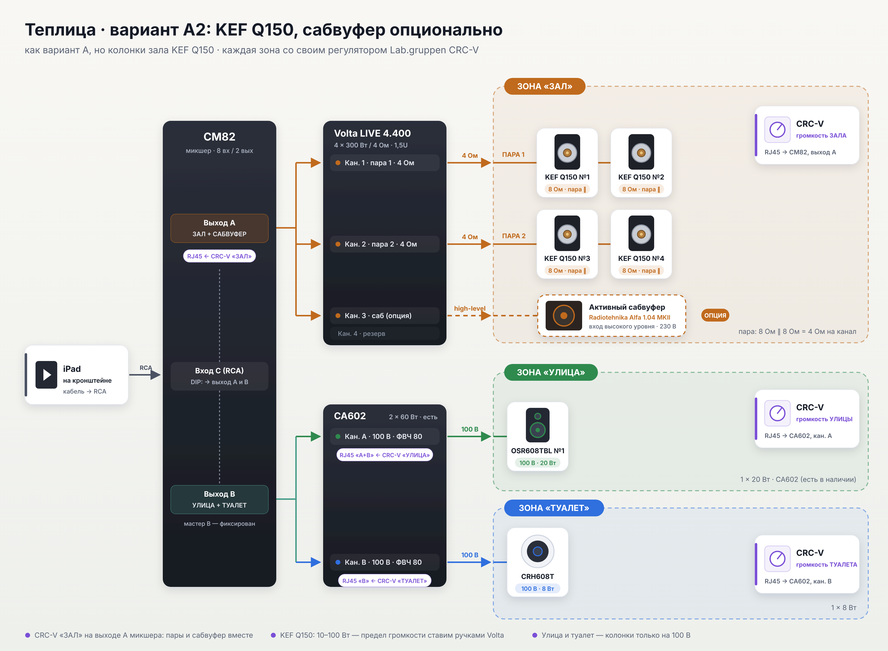
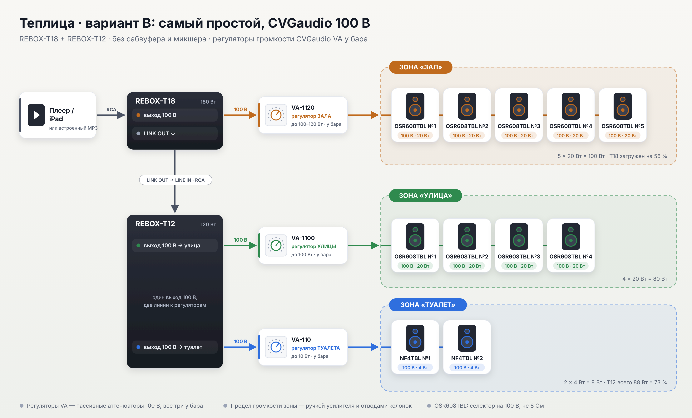
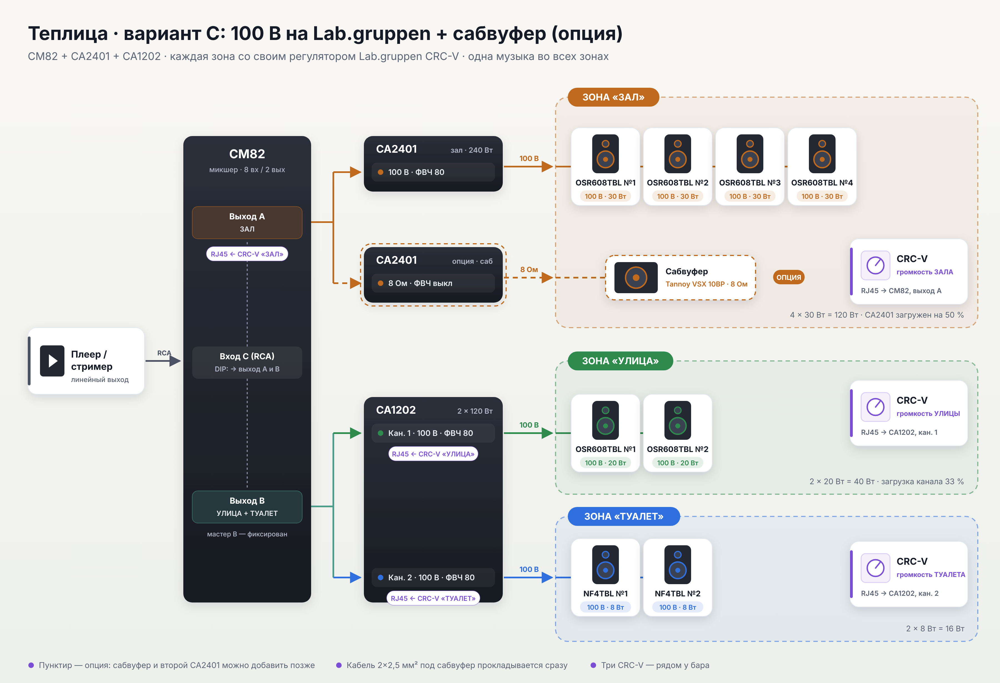

# Теплица: звуковая система, варианты A / A2 / B / C

Во всех вариантах три зоны: **зал (4 колонки), улица (1 колонка) и туалет (1 потолочная колонка)**. Везде играет
одна музыка, источник — **iPad на кронштейне** у шкафа, у каждой зоны свой регулятор громкости.

**Для руководства:** [`Teplica-zvuk-proekt.pdf`](Teplica-zvuk-proekt.pdf) — проект на согласование по трём вариантам (рекомендуем A); 15 страниц, с фото колонок.
**Смета:** [Google Sheets](https://docs.google.com/spreadsheets/d/1uV0goTIWzc8BjLMTEEd3xBQX1XKyCQEsck7-6BgJBb0/edit) — основной документ;
копии: [ESTIMATE.md](ESTIMATE.md), [smeta-teplica.xlsx](smeta-teplica.xlsx).
**Расстановка:** [`placement-plan.png`](placement-plan.png). **Место управления (iPad, регуляторы, шкаф):** [`wall-ipad-controls.png`](wall-ipad-controls.png).
**Габариты сабвуфера и KEF:** [`sizes-sub-kef.png`](sizes-sub-kef.png). **Фото колонок** (KEF Q350/Q150 во всех цветах, CVGaudio OSR608): [`photos/`](photos/).

Место управления: шкаф низом на 2000 мм (выше головы), iPad и три CRC-V рядом на высоте 1700 мм (выше плеча).

| | **A** — [KEF Q350](A-kef-volta-sub/README.md) | **A2** — [KEF Q150](A2-kef-q150/README.md) | **B** — [CVGaudio 100 В](B-cvg-100v/README.md) | **C** — [Lab.gruppen 100 В](C-labgruppen-100v-sub/README.md) |
|---|---|---|---|---|
| Зал | 2 пары KEF Q350 | 2 пары KEF Q150 | 4 × OSR608TBL, 100 В | 4 × OSR608TBL, 100 В |
| Улица / туалет | 1 × OSR608TBL / 1 × CRH608T (есть) | то же | то же | то же |
| Электроника | CM82 + Volta LIVE 4.400 + CA602 (есть) | как A | CVGaudio M-123Tm | CM82 + CA2401 + CA602 (есть) |
| Регуляторы | 3 × Lab.gruppen CRC-V | 3 × CRC-V | 3 × CVGaudio VA | 3 × CRC-V |
| Сабвуфер | опция: Radiotehnika (+49 990) | опция: Radiotehnika (+49 990) | нет | опция: KM750 + Radiotehnika (+71 465) |
| **Без сабвуфера** | **264 046 ₽** | **244 046 ₽** | **176 823 ₽** | **238 513 ₽** |
| **С сабвуфером** | **314 036 ₽** | **294 036 ₽** | — | **309 978 ₽** |

> Сметы A и A2 в этом репозитории и в PDF уже с сабвуфером в опции и с вариантом A2; в Google-таблице этих изменений пока нет.

### Схемы

| A | A2 | B | C |
|---|---|---|---|
|  |  |  |  |

### Как выбрать

- **Важен звук зала** → **A** (KEF Q350, рекомендуем) или **A2** (KEF Q150, дешевле на 20 000 ₽). A2 без сабвуфера дороже C всего на 5 533 ₽, а с сабвуфером дешевле C с сабвуфером на 15 942 ₽.
- **Нужно дёшево и быстро,** музыка просто «чтобы играла» → **B**. Регуляторы зон в этом варианте
  не Lab.gruppen: CRC-V работает только с усилителями Lab.gruppen.
- **Нужно управление Lab.gruppen по зонам и простая надёжная трансляционная система,** а сабвуфер
  по бюджету можно отложить → **C**.

### Управление по зонам (A и C)

Руководства Lab.gruppen подтвердили схему с тремя CRC-V:

- **У двухканальных CA (CA602, CA1202, CA2402) по два разъёма RJ45:** «A+B» (контакт 2 — канал A, контакт 3 — канал B)
  и «B» (канал B). Получается свой регулятор на каждый канал.
- **У CM82 то же самое по выходам A и B.**

Осталось проверить при монтаже одно: что CRC-V в разъёме «A+B» управляет только каналом A.
