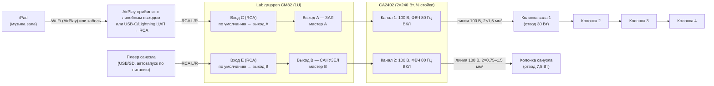

# Заведение № 2: две зоны на Lab.gruppen CM82 + CA

Две полностью независимые зоны, у каждой свой источник музыки и своя громкость:

| Зона | Источник | Выход CM82 | Усиление |
|---|---|---|---|
| **Зал** | iPad | A | CA2402, канал 1 |
| **Санузел** | отдельный плеер | B | CA2402, канал 2 (отдельный канал усиления) |

В зале и в санузле играет разная музыка. Каждую можно включить, выключить или сделать тише,
не трогая вторую.

---

## 1. Схема

Картинкой: [`schema.svg`](schema.svg). Спецификация: [`bom.csv`](bom.csv).

### Почему маршрутизация «из коробки» подходит

На CM82 по умолчанию входы **A–D идут на выход A**, а входы **E–H на выход B**. Поэтому:

- iPad на входе C попадает только в зал;
- плеер на входе E попадает только в санузел;
- **все DIP-переключатели маршрутизации остаются выключенными.** Если какой-то из них включить,
  музыка одной зоны начнёт подмешиваться в другую.

---

## 2. Источники

### Зал: iPad

Два способа подключить iPad к входу C (RCA):

1. **По Wi-Fi через AirPlay-приёмник** с линейным выходом RCA (рекомендуется).
   - iPad остаётся у персонала, его можно носить по залу и заряжать как угодно.
   - Приёмник стоит в шкафу и включается вместе со всей системой.
   - Приёмник и iPad должны быть в одной сети Wi-Fi. Лучше отдельная сеть для персонала,
     не гостевая.
2. **По кабелю**: ЦАП-адаптер USB-C (или Lightning) с выходом на mini-jack, затем кабель mini-jack → 2×RCA.
   - Проще и дешевле, но iPad привязан к шкафу кабелем.
   - Чтобы iPad одновременно заряжался, нужен USB-C хаб с аудиовыходом и сквозной зарядкой (PD).

**Настройка iPad**, иначе в зал попадут системные звуки:

- включить режим «Не беспокоить» / Фокус, отключить звуки уведомлений и клавиатуры;
- громкость на iPad: 90–100 %, дальше регулировать мастером A на CM82;
- по желанию: «Гид-доступ», чтобы на iPad было открыто только приложение с музыкой.

### Санузел: отдельный плеер

- **Встроенного плеера у усилителей CA и у CM82 нет**, поэтому плеер ставится отдельно.
- Лучший вариант для санузла: простой **USB/SD-плеер в стойку 1U с автозапуском**.
  - После включения питания он сам начинает играть плейлист по кругу.
  - Персоналу ничего не нужно нажимать, музыка не пропадёт после отключения электричества.
- Подойдёт и любой другой источник с линейным выходом: второй AirPlay-приёмник, старый смартфон,
  стример. Главное, чтобы он умел стартовать сам после перезапуска.
- Если плеер обязательно должен быть встроен в усилитель, это уже другой класс оборудования
  (микшер-усилитель с USB/Bluetooth). Тогда уходим от связки CM82 + CA, см. раздел 6.

---

## 3. Усиление и линии

Один усилитель **CA2402** закрывает обе зоны. Каналы работают независимо.

| Линия | Канал / режим | Нагрузка | Кабель | Импеданс линии (1 кГц) |
|---|---|---|---|---|
| L1 «Зал» | кан. 1 / **100 В**, ФВЧ 80 Гц ВКЛ | 4 колонки × 30 Вт шлейфом = 120 Вт (50 % канала) | 2×1,5 мм² | ≈ 83 Ом |
| L2 «Санузел» | кан. 2 / **100 В**, ФВЧ 80 Гц ВКЛ | 1–2 колонки × 7,5 Вт | 2×0,75–1,5 мм² | ≈ 1333 Ом (1 шт.) / 667 Ом (2 шт.) |

- **Запас.** На линию зала можно добавить ещё 2 колонки по 30 Вт: предел загрузки 80 %, то есть 192 Вт.
- **Защита колонки санузла.** На линии 100 В колонка с отводом 7,5 Вт не получит больше своего отвода,
  поэтому мощный канал для неё безопасен.

---

## 4. Входы CM82

| Вход | Источник | Разъём | Маршрут | DIP |
|---|---|---|---|---|
| A | (резерв: микрофон объявлений в зал, вход с приоритетом) | Euroblock 5-pin | выход A | выкл |
| B–D | резерв для зала | | выход A | выкл |
| **C** | **iPad** (через AirPlay-приёмник или ЦАП) | RCA L/R, сумма в моно | **выход A — зал** | **выкл** |
| **E** | **плеер санузла** | RCA L/R, сумма в моно | **выход B — санузел** | **выкл** |
| F–H | резерв для санузла | | выход B | выкл |

Выходы: **A → CA2402 вход кан. 1**, **B → CA2402 вход кан. 2**. Это симметричные перемычки
Euroblock внутри шкафа.

---

## 5. Настройка

1. **CA2402**: оба канала в режим **100 V**, ФВЧ **ON**.
2. **Колонки**: зал на отвод **30 W**, санузел на **7,5 W**. Положение «low impedance» на линии 100 В
   **не использовать**.
3. **CM82**: все DIP-переключатели маршрутизации выключены. Фантомное питание выключено.
4. Прозвонить линии измерителем импеданса и сверить с таблицей раздела 3.
5. Включать по порядку: источники → CM82 → CA2402. Все регуляторы сначала в минимуме.
6. **Зал**
   - На iPad громкость 90–100 %. Регулятор входа C на CM82 поднять так, чтобы на пиках
     не загоралась перегрузка.
   - Мастер A поставить в максимум. Регулятор кан. 1 CA2402 поднимать до **максимально допустимого
     уровня** в зале, например 80–85 дБА, и зафиксировать.
   - Дальше персонал регулирует зал мастером A и не может превысить этот максимум.
7. **Санузел**
   - Регулятор входа E выставить по индикатору так же, как вход C.
   - Мастером B или регулятором кан. 2 CA2402 выставить 60–70 дБА в помещении.
8. **Проверка независимости.** Поставьте паузу на iPad: в санузле музыка должна играть дальше.
   Выключите плеер санузла: в зале ничего не должно измениться.

---

## 6. Варианты

- **Сабвуфер в зал.** Добавить CA2401 (8 Ом) на выход A параллельно кан. 1, как в первом проекте
  (`../sound/`).
- **Колонки зала 8 Ом вместо 100 В.** Две пары по 8 Ом параллельно на CA1202 (4 Ом на канал), как
  в первом проекте. Тогда санузел уходит на отдельный усилитель, например CA602 / CA601 в режиме 100 В.
- **Регулятор громкости зала у бара.** Настенный регулятор по RJ45 на CM82 (совместимость уточнить).
- **Плеер, встроенный в усилитель.** Связка CM82 + CA так не умеет. Нужен микшер-усилитель
  с USB/Bluetooth-плеером. Если это принципиально, подберу отдельно.

---

## 7. Что уточнить

1. Площадь и план зала, тип потолка: от этого зависят количество колонок и их тип.
2. Нужен ли в зале сабвуфер.
3. Сколько санузлов.
4. iPad по Wi-Fi или по кабелю. Есть ли в заведении стабильный Wi-Fi для персонала.
5. Где будет стоять шкаф с оборудованием.

Перед закупкой сверьте по руководству CM82 маршрутизацию входов по умолчанию (A–D → A, E–H → B)
и раздельную регулировку каналов CA2402.
