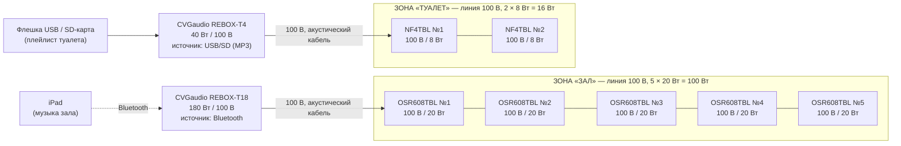

# 9-я линия В.О., 60: звук на две зоны (CVGaudio)

Две независимые зоны, у каждой свой источник, свой усилитель и своя громкость:

| Зона | Источник | Усилитель | Колонки |
|---|---|---|---|
| **Зал** | iPad по Bluetooth, напрямую в усилитель | CVGaudio **REBOX-T18** (180 Вт, 100 В) | 5 × **OSR608TBL** |
| **Туалет** | встроенный USB/SD-плеер усилителя | CVGaudio **REBOX-T4** (40 Вт, 100 В) | 2 × **NF4TBL** |

Между iPad и усилителем нет промежуточных устройств: iPad подключается к встроенному Bluetooth
REBOX-T18. Туалет играет с флешки во встроенном MP3-плеере REBOX-T4, отдельный плеер не нужен.

---

## 1. Схема

Картинкой: [`schema.svg`](schema.svg). Смета: [`bom.csv`](bom.csv).

Колонки каждой зоны подключаются к своему усилителю **параллельно, шлейфом**: от усилителя
к первой колонке, от неё ко второй и так далее. «+» к «+», «−» к «−».

---

## 2. Зона «Зал»: REBOX-T18 + 5 × OSR608TBL

### Подключение iPad

1. На REBOX-T18 выбрать источник **Bluetooth** и сопрячь с ним iPad (один раз).
2. **Сопрягать iPad только с T18.** У REBOX-T4 тоже есть Bluetooth. Если iPad когда-нибудь
   подключится к нему, музыка зала уйдёт в туалет. На iPad в списке Bluetooth-устройств T4
   быть не должно, а сам T4 всегда работает в режиме USB/SD.
3. Громкость на iPad: 90–100 %. Регулировать громкость зала ручкой на REBOX-T18.
4. На iPad включить «Не беспокоить» / Фокус, выключить звуки уведомлений и клавиатуры. Иначе они
   попадут в зал.

**Что учесть с Bluetooth**

- Устойчивая связь примерно до 10 м, лучше в прямой видимости. Усилитель не прятать в металлический
  шкаф и в дальнее подсобное помещение за несколькими стенами.
- После отключения питания проверьте, переподключается ли iPad к T18 сам. Если нет, персонал
  выбирает T18 в меню Bluetooth на iPad.
- Запасной вариант без Bluetooth: кабель от iPad в линейный вход RCA на T18 (для iPad с USB-C нужен
  адаптер USB-C → mini-jack и кабель mini-jack → 2×RCA).

### Колонки OSR608TBL

- Переключатель на задней стенке: **100 В / 20 Вт** на всех пяти колонках.
- 5 × 20 Вт = **100 Вт** из 180 Вт (56 %). Запас нормальный.
- Если в зале тихо, можно поставить **30 Вт**: 5 × 30 = 150 Вт (83 %), это почти предел.
- **Положение 40 Вт не использовать**: 5 × 40 = 200 Вт, больше мощности усилителя.
- **Положение 8 Ом на линии 100 В запрещено.** Колонка сгорит, усилитель уйдёт в защиту.
- Колонку у барной стойки или кассы можно поставить на 10 Вт, чтобы персоналу было комфортно.

---

## 3. Зона «Туалет»: REBOX-T4 + 2 × NF4TBL

- Источник на REBOX-T4: **USB** (или SD). На флешке папка с MP3, режим повтора всего плейлиста.
- **Проверить при монтаже**: продолжает ли T4 играть флешку сам после отключения и включения питания.
  Если нет, персоналу нужно знать, что утром на T4 надо нажать Play.
- Колонки NF4TBL: отвод **8 Вт**. 2 × 8 = **16 Вт** из 40 Вт.
- Если нужно громче, можно 16 Вт: 2 × 16 = 32 Вт (80 %), это предел.
- Громкость туалета ручкой на REBOX-T4. Выставляется один раз, обычно 60–70 дБА.

---

## 4. Линии

| Зона | Усилитель | Нагрузка | Кабель | Импеданс линии (1 кГц) |
|---|---|---|---|---|
| Зал | REBOX-T18, выход 100 В | 5 × 20 Вт = 100 Вт | 2×0,75–1,5 мм² | ≈ 100 Ом (при 30 Вт ≈ 67 Ом) |
| Туалет | REBOX-T4, выход 100 В | 2 × 8 Вт = 16 Вт | 2×0,75–1,5 мм² | ≈ 625 Ом (при 16 Вт ≈ 312 Ом) |

- Перед подключением к усилителям проверить линии измерителем импеданса и убедиться, что нет короткого
  замыкания. Обычный омметр покажет почти ноль из-за трансформаторов, для этих линий он не годится.
- **Кабеля в смете 50 м на обе зоны.** Для 7 колонок этого может не хватить: только шлейф по залу
  на 5 колонок легко занимает 30–40 м. Посчитайте трассы по плану до закупки.

---

## 5. Порядок запуска

1. Колонки выставить на отводы: зал **100 В / 20 Вт**, туалет **8 Вт**.
2. Прозвонить линии, подключить к выходам 100 В усилителей.
3. Все ручки громкости в минимум, включить оба усилителя.
4. **T18**: источник Bluetooth, сопрячь iPad. Громкость на iPad 90–100 %. Поднять громкость на T18
   до максимально нужного уровня в зале и запомнить это положение.
5. **T4**: источник USB, вставить флешку, включить повтор. Выставить громкость в туалете.
6. Тембр (BASS / TREBLE) на каждом усилителе по вкусу.
7. **Проверка независимости.** Пауза на iPad: в туалете музыка играет дальше. Выключили T4:
   в зале ничего не изменилось.
8. Отключить и включить питание обоих усилителей. Проверить, что iPad переподключается к T18,
   а T4 снова играет флешку.

---

## 6. Что уточнить

1. Где будут стоять усилители: близко ли это к месту, где лежит iPad (для Bluetooth).
2. Длины трасс до колонок, чтобы проверить, хватит ли 50 м кабеля.
3. Нужен ли микрофон для объявлений. У обоих усилителей есть приоритетный микрофонный вход.

Характеристики взяты из карточек магазинов и сайта CVGaudio. Перед монтажом сверьте отводы колонок
и функции плеера (автовоспроизведение) по паспортам.
