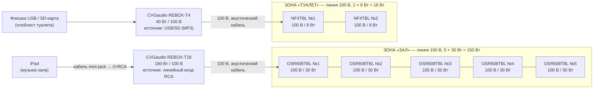

# 9-я линия В.О., 60: звук на две зоны (CVGaudio)

Две независимые зоны, у каждой свой источник, свой усилитель и своя громкость:

| Зона | Источник | Усилитель | Колонки |
|---|---|---|---|
| **Зал** | iPad, кабелем прямо в линейный вход усилителя | CVGaudio **REBOX-T18** (180 Вт, 100 В) | 5 × **OSR608TBL** |
| **Туалет** | встроенный USB/SD-плеер усилителя | CVGaudio **REBOX-T4** (40 Вт, 100 В) | 2 × **NF4TBL** |

Между iPad и усилителем нет промежуточных устройств, только кабель. Туалет играет с флешки во встроенном
MP3-плеере REBOX-T4, отдельный плеер не нужен.

---

## 1. Схема

Картинкой: [`schema.svg`](schema.svg). Смета: [`bom.csv`](bom.csv).

Колонки каждой зоны подключаются к своему усилителю **параллельно, шлейфом**: от усилителя
к первой колонке, от неё ко второй и так далее. «+» к «+», «−» к «−».

---

## 2. Зона «Зал»: REBOX-T18 + 5 × OSR608TBL

### Подключение iPad

- **Кабель от iPad в линейный вход RCA** на REBOX-T18. Источник на T18: этот линейный вход.
  - iPad с USB-C: адаптер USB-C → mini-jack 3,5 мм и кабель mini-jack → 2×RCA.
  - iPad с Lightning: адаптер Lightning → mini-jack и тот же кабель.
  - **В смете этих позиций нет**, их нужно добавить.
- iPad стоит рядом с усилителем. Длину кабеля mini-jack → RCA лучше брать не больше 3–5 м.
- Если iPad должен одновременно заряжаться, нужен адаптер со сквозной зарядкой (USB-C хаб с PD
  и аудиовыходом).
- Громкость на iPad: 90–100 %. Регулировать громкость зала ручкой на REBOX-T18.
- На iPad включить «Не беспокоить» / Фокус, выключить звуки уведомлений и клавиатуры. Иначе они
  попадут в зал.

### Мощность: можно ли поставить колонки на 40 Вт

**Нет, 5 × 40 Вт на T18 не помещается.**

| Отводы OSR608TBL | Сумма | Загрузка T18 (180 Вт) | Импеданс линии | Вердикт |
|---|---|---|---|---|
| 5 × 40 Вт | **200 Вт** | **111 %** | 50 Ом (минимум для T18 ≈ 56 Ом) | **перегрузка, нельзя** |
| 4 × 40 + 1 × 20 Вт | 180 Вт | 100 % | ≈ 56 Ом | формально впритык, без запаса, не рекомендуется |
| 2 × 40 + 3 × 30 Вт | 170 Вт | 94 % | ≈ 59 Ом | допустимо, запас минимальный |
| **5 × 30 Вт** | **150 Вт** | **83 %** | ≈ 67 Ом | **рекомендуется** |
| 5 × 20 Вт | 100 Вт | 56 % | 100 Ом | с большим запасом, для тихого фона |

**Почему 40 Вт того не стоит**

- Разница между отводами 40 и 30 Вт всего **+1,25 дБ**, на слух почти незаметно.
- Ради этой прибавки усилитель на громких местах работает за пределами своей мощности:
  - перегрев;
  - уход в защиту, то есть музыка пропадает посреди вечера;
  - клиппинг, звук становится грязным.
- Сумма отводов не должна превышать номинальную мощность усилителя. Хорошая практика: не больше
  80–90 % от неё.

**Как решить, если нужно громче**

- **Колонки у столиков или барной стойки** поставить тише, чем дальние. Например, 2 дальние на 40 Вт,
  3 остальные на 30 Вт: в сумме 170 Вт.
- **Если нужно 40 Вт на всех пяти колонках**, нужен усилитель мощностью от 250 Вт (200 Вт / 0,8).

**Ещё про колонки**

- **Положение 8 Ом на линии 100 В запрещено.** Колонка сгорит, усилитель уйдёт в защиту.
- Колонку у барной стойки или кассы можно поставить на 10–20 Вт, чтобы персоналу было комфортно.

---

## 3. Зона «Туалет»: REBOX-T4 + 2 × NF4TBL

- Источник на REBOX-T4: **USB** (или SD). На флешке папка с MP3, режим повтора всего плейлиста.
- **Проверить при монтаже**: продолжает ли T4 играть флешку сам после отключения и включения питания.
  Если нет, персоналу нужно знать, что утром на T4 надо нажать Play.
- Колонки NF4TBL: отвод **8 Вт**. 2 × 8 = **16 Вт** из 40 Вт.
- Если нужно громче, можно 16 Вт: 2 × 16 = 32 Вт (80 %), это предел.
- Громкость туалета ручкой на REBOX-T4. Выставляется один раз, обычно 60–70 дБА.
- У T4 есть встроенный Bluetooth. Чтобы к нему никто случайно не подключился, держите T4 в режиме USB/SD.

---

## 4. Линии

| Зона | Усилитель | Нагрузка | Кабель | Импеданс линии (1 кГц) |
|---|---|---|---|---|
| Зал | REBOX-T18, выход 100 В | 5 × 30 Вт = 150 Вт | 2×0,75–1,5 мм² | ≈ 67 Ом (не ниже 56 Ом) |
| Туалет | REBOX-T4, выход 100 В | 2 × 8 Вт = 16 Вт | 2×0,75–1,5 мм² | ≈ 625 Ом (при 16 Вт ≈ 312 Ом) |

- Перед подключением к усилителям проверьте линии измерителем импеданса и убедитесь, что нет
  короткого замыкания. Обычный омметр из-за трансформаторов покажет почти ноль, для этих линий
  он не годится.
- **Если импеданс линии зала ниже 56 Ом, линия перегружена.** Проверьте отводы на колонках.
- **Кабеля в смете 50 м на обе зоны.** Для 7 колонок этого может не хватить: только шлейф по залу
  на 5 колонок легко занимает 30–40 м. Посчитайте трассы по плану до закупки.

---

## 5. Порядок запуска

1. Выставьте отводы на колонках: зал **100 В / 30 Вт**, туалет **8 Вт**.
2. Прозвоните линии и подключите их к выходам 100 В усилителей.
3. Все ручки громкости в минимум, включите оба усилителя.
4. **T18**
   - Подключите iPad кабелем, источник на T18: линейный вход.
   - Громкость на iPad 90–100 %.
   - Поднимите громкость на T18 до максимально нужного уровня в зале. Индикатор перегрузки
     или клиппинга на пиках не должен загораться. Запомните это положение.
5. **T4**: источник USB, вставьте флешку, включите повтор. Выставьте громкость в туалете.
6. Тембр (BASS / TREBLE) на каждом усилителе по вкусу.
7. **Проверьте независимость зон.** Пауза на iPad: в туалете музыка играет дальше. Выключили T4:
   в зале ничего не изменилось.
8. Отключите и включите питание T4. Он должен снова заиграть флешку.

---

## 6. Что уточнить

1. Где будут стоять усилитель зала и iPad: нужен короткий кабель между ними.
2. Модель iPad (USB-C или Lightning), нужна ли зарядка во время работы.
3. Длины трасс до колонок, чтобы проверить, хватит ли 50 м кабеля.
4. Нужен ли микрофон для объявлений. У обоих усилителей есть приоритетный микрофонный вход.

Характеристики взяты из карточек магазинов и сайта CVGaudio. Перед монтажом сверьте по паспортам
отводы колонок, номинальную мощность T18 и автовоспроизведение плеера T4.
